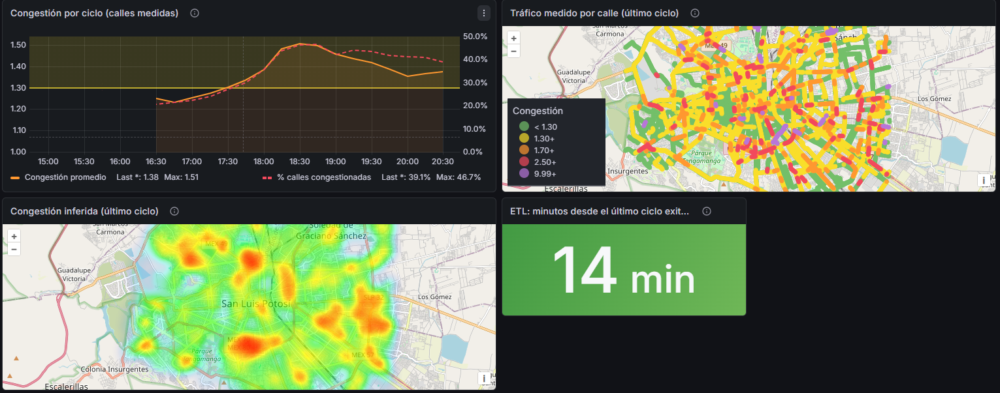
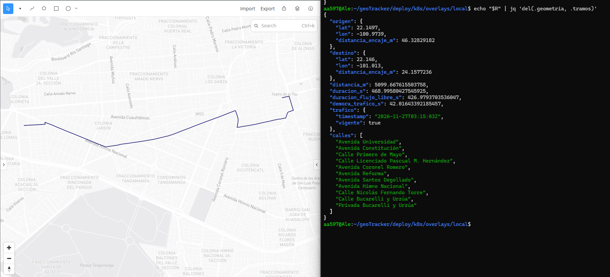
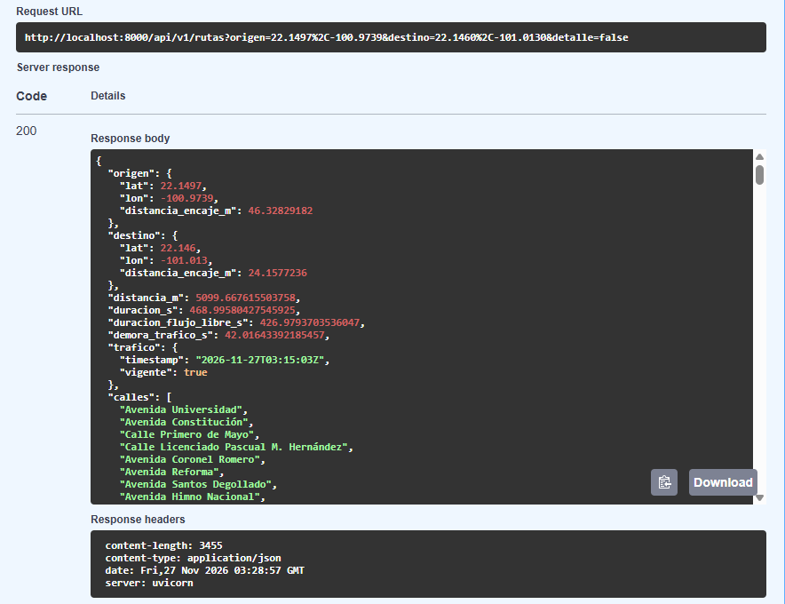
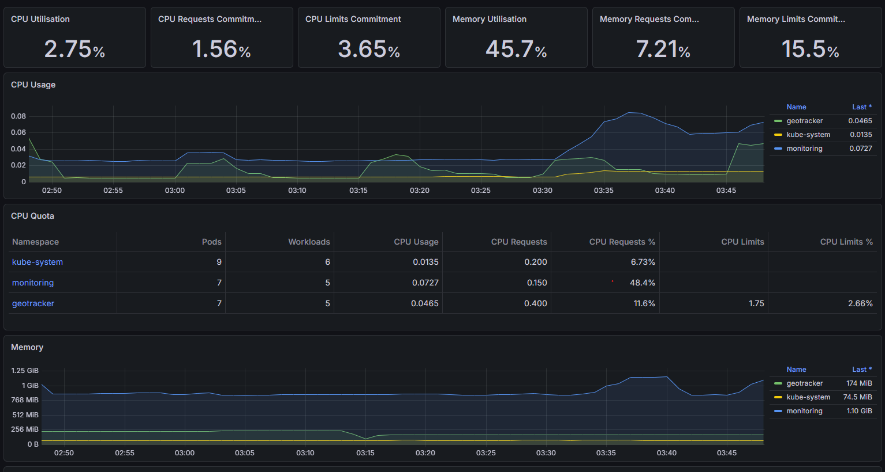
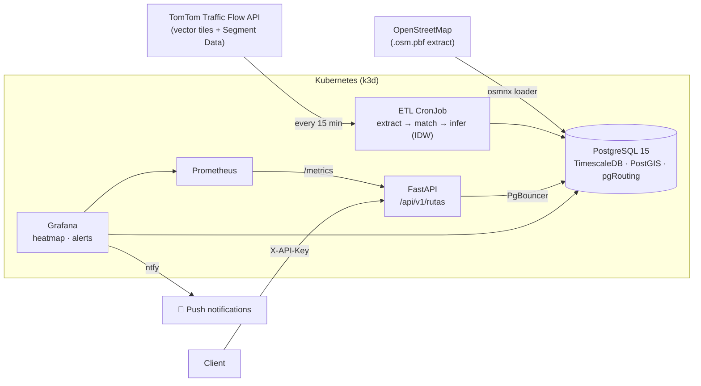

# geoTracker

**Real-time traffic monitoring and traffic-aware routing for the San Luis Potosí metropolitan area (Mexico).**

geoTracker measures road traffic every 15 minutes with the TomTom Traffic Flow API, stores the history in
TimescaleDB, infers congestion over the **entire OpenStreetMap road network** (≈67 000 directed street segments)
and exposes a REST API that computes the **fastest route between two points using current traffic** (Dijkstra on
pgRouting). Everything runs on Kubernetes, with Prometheus/Grafana dashboards, alerts as code and push
notifications.

---

## Table of contents

- [Visual demo](#visual-demo)
- [How it works](#how-it-works)
- [Tech stack](#tech-stack)
- [Prerequisites](#prerequisites)
- [Getting started](#getting-started)
- [Usage examples](#usage-examples)
- [Project structure](#project-structure)
- [Roadmap](#roadmap)
- [Documentation](#documentation)

---

## Visual demo

| Traffic heatmap (Grafana) | Fastest route with traffic |
|---|---|
|  |  |

| API docs (Swagger UI) | Kubernetes cluster resources |
|---|---|
|  |  |

---

## How it works



1. **Ingestion** — An async ETL (`aiohttp`) downloads 49 TomTom Traffic Flow vector tiles (zoom 14) covering the
   study area, plus point readings from Flow Segment Data. A request budget keeps usage within the monthly quota.
2. **Map matching** — Each traffic segment is matched in PostGIS to the **directed** OSM edges it covers.
3. **Inference** — Measured edges keep their value; every other street gets an **IDW** estimate
   (K = 5 neighbours, p = 2, 600 m radius) from nearby open measurements. Results land in a TimescaleDB hypertable.
4. **Routing** — Edge cost = travel time in seconds under the latest traffic cycle (< 30 min old, otherwise
   free-flow). `pgr_dijkstra` runs on a directed graph that excludes closed roads.
5. **Observability** — Grafana heatmap, ETL run log, alert rules as code and phone notifications via ntfy.

---

## Tech stack

| Area | Technologies |
|---|---|
| **Languages** | Python 3.11 / 3.12, SQL (PL/pgSQL), Bash |
| **API** | FastAPI 0.115, Uvicorn, Pydantic 2, SQLAlchemy 2, `prometheus-fastapi-instrumentator` |
| **ETL & geospatial** | aiohttp, osmnx 2.1, GeoPandas, Shapely, pyproj, SciPy (IDW), `mapbox-vector-tile`, osmium |
| **Database** | PostgreSQL 15.2, TimescaleDB 2.10.2 (hypertables), PostGIS 3.3, pgRouting 4.0.1, PgBouncer 1.22 |
| **Data sources** | TomTom Traffic Flow API (vector tiles + Flow Segment Data), OpenStreetMap |
| **Infrastructure** | Docker, Kubernetes (k3d), Kustomize, Helm |
| **Observability** | kube-prometheus-stack (Prometheus + Grafana 13), Grafana Alerting, ntfy |
| **Testing** | pytest, httpx |
| **Planned** | Azure AKS, Terraform, CloudNativePG, Ansible, CI/CD |

---

## Prerequisites

| Tool | Minimum version | Notes |
|---|---|---|
| Docker | 24+ | Builds the images and hosts the k3d cluster. On Windows, use WSL 2. |
| k3d | 5.6+ | Local Kubernetes cluster (k3s in Docker). |
| kubectl | 1.29+ | Includes Kustomize (`kubectl apply -k`). |
| Helm | 3.17 | Optional: can run from the `alpine/helm:3.17.3` container instead. |
| Python | 3.11 | Only to run tests or scripts outside the containers. |
| TomTom API key | — | Free developer plan from [developer.tomtom.com](https://developer.tomtom.com). |

**Hardware:** ~4 GB of free RAM for the full stack (database, ETL, API, Prometheus and Grafana) and ~10 GB of disk
for the database volume and images.

**Quotas:** the request budget defaults to TomTom's free plan (200 000 tile requests and 20 000 Segment Data
requests per month). If your plan differs, set `TOMTOM_TILES_CUOTA_MENSUAL` and `TOMTOM_CUOTA_MENSUAL`.

> ⚠️ The database image is pinned (PostgreSQL 15.2 / TimescaleDB 2.10.2 / pgRouting 4.0.1). Do not upgrade it
> without planning the extension upgrade.

---

## Getting started

### 1. Create the cluster and build the images

```bash
k3d cluster create geotracker --agents 2

docker build -t geotracker-timescaledb:pg15.2-ts2.10.2 ./db
docker build -t geotracker-api:latest ./services/api
docker build -t geotracker-etl:latest .

# Import one image per command
k3d image import geotracker-timescaledb:pg15.2-ts2.10.2 -c geotracker
k3d image import geotracker-api:latest -c geotracker
k3d image import geotracker-etl:latest -c geotracker
```

### 2. Configure secrets (kept out of git)

```bash
cp deploy/k8s/overlays/local/secret.env.example  deploy/k8s/overlays/local/secret.env
cp deploy/k8s/overlays/local/grafana.env.example deploy/k8s/overlays/local/grafana.env
```

`secret.env`:

```dotenv
DB_PASSWORD=<strong password>
TOMTOM_API_KEY=<your TomTom key>
API_TOKENS=<openssl rand -hex 32>      # one or more, comma-separated, >= 32 chars
```

`grafana.env` takes the Grafana admin credentials, the read-only DB role password and an optional ntfy topic URL.

### 3. Deploy observability and the application

```bash
# Prometheus + Grafana (creates the monitoring namespace and CRDs)
helm upgrade --install kps oci://ghcr.io/prometheus-community/charts/kube-prometheus-stack \
  --version 93.3.0 -n monitoring --create-namespace \
  -f deploy/k8s/platform/kube-prometheus-stack/values.yaml \
  -f deploy/k8s/platform/kube-prometheus-stack/values-local.yaml

# Database, PgBouncer, migrations, API, ETL CronJob, OSM loader, dashboards
kubectl apply -k deploy/k8s/overlays/local

kubectl get pods,cronjob -n geotracker
```

The migrations `Job` creates the schema, and the OSM loader `Job` downloads the state's `.osm.pbf` extract and builds
the routing graph. From then on, the ETL `CronJob` runs every 15 minutes.

---

## Usage examples

### Fastest route with current traffic

```bash
kubectl port-forward -n geotracker svc/geotracker-api 8000:80 &

curl -H "X-API-Key: $TOKEN" \
  'http://localhost:8000/api/v1/rutas?origen=22.1497,-100.9739&destino=22.1460,-101.0130'
```

Response (a real one, with `calles` and `geometria` truncated):

```json
{
  "origen":  { "lat": 22.1497, "lon": -100.9739, "distancia_encaje_m": 46.33 },
  "destino": { "lat": 22.146,  "lon": -101.013,  "distancia_encaje_m": 24.16 },
  "distancia_m": 5099.67,
  "duracion_s": 468.99,
  "duracion_flujo_libre_s": 426.98,
  "demora_trafico_s": 42.02,
  "trafico": { "timestamp": "2026-11-27T03:15:03Z", "vigente": true },
  "calles": ["Avenida Universidad", "Avenida Constitución", "Calle Primero de Mayo", "...", "Privada Bucarelli y Urzúa"],
  "geometria": { "type": "LineString", "coordinates": [[-100.9739, 22.1497], "..."] },
  "tramos": null
}
```

Tip: pipe the response through `jq` to read it, e.g. `jq 'del(.geometria, .tramos)'` for the summary, or
`jq '{type:"Feature", properties:{}, geometry:.geometria}' > ruta.geojson` to draw the route on
[geojson.io](https://geojson.io).

| Parameter | Description |
|---|---|
| `origen`, `destino` | `lat,lon` in WGS84 |
| `detalle` | `true` adds per-edge detail (`tramos`: OSM id, road type, length, seconds with and without traffic) |

| Status | Meaning |
|---|---|
| `200` | Route found. `trafico.vigente = false` means no recent traffic, so the route uses free-flow speeds. |
| `401` | Missing or invalid `X-API-Key`. |
| `404` | No route between the two points. |
| `422` | Invalid format, or a coordinate more than 300 m from the road network. |

Interactive documentation: `http://localhost:8000/docs`.

### From Python

```python
import httpx

resp = httpx.get(
    "http://localhost:8000/api/v1/rutas",
    params={"origen": "22.1497,-100.9739", "destino": "22.1460,-101.0130", "detalle": True},
    headers={"X-API-Key": TOKEN},
)
ruta = resp.json()
print(f"{ruta['distancia_m'] / 1000:.1f} km, "
      f"{ruta['duracion_s'] / 60:.0f} min (+{ruta['demora_trafico_s'] / 60:.0f} min of traffic)")
```

### Directly in SQL

```bash
kubectl exec -it -n geotracker geotracker-db-0 -- sh -c 'psql -U "$POSTGRES_USER" -d "$POSTGRES_DB"'
```

```sql
-- Fastest route as a table of edges (same function used by the API)
SELECT seq, nombre, tipo_via, round(longitud_m) AS m, round(segundos_acumulados) AS s
FROM ruta_mas_rapida(22.1497, -100.9739, 22.1460, -101.0130);

-- Most congested streets in the latest cycle
-- nivel_congestion_inf = current travel time / free-flow travel time (1.0 = free flow)
SELECT c.nombre, c.tipo_via, t.nivel_congestion_inf, t.metodo_inferencia
FROM trafico_calles t
JOIN dim_calles_osm c ON c.osm_id = t.osm_id
WHERE t.timestamp_calculo = (SELECT max(timestamp_calculo) FROM trafico_calles)
  AND c.nombre IS NOT NULL
ORDER BY t.nivel_congestion_inf DESC
LIMIT 10;
```

### Health and metrics (no token required)

```bash
curl localhost:8000/health/live     # liveness (does not touch the database)
curl localhost:8000/health/ready    # readiness (503 if the database is down)
curl localhost:8000/metrics         # Prometheus metrics
```

### Grafana and operations

```bash
kubectl port-forward -n monitoring svc/kps-grafana 3001:80          # http://localhost:3001
kubectl logs -n geotracker job/<geotracker-etl-NNN>                 # logs of one ETL cycle
```

### Tests

```bash
PYTHONPATH=src pytest tests/                                # ETL, inference, matching
PYTHONPATH=src:services/api pytest services/api/tests       # API
```

---

## Project structure

```
geoTracker/
├── src/                  # ETL: extraction, matching, IDW inference, migrations runner
├── services/api/         # FastAPI routing service
├── scripts/              # One-off preparation: monitoring points, OSM network loader
├── db/
│   ├── Dockerfile        # Pinned PostgreSQL + TimescaleDB + PostGIS + pgRouting image
│   └── migrations/       # Versioned, idempotent DDL (NNN_name.sql)
├── deploy/k8s/
│   ├── base/             # Namespace, DB, PgBouncer, API, ETL CronJob, Jobs, Ingress
│   ├── overlays/local/   # k3d overlay (secrets generated from *.env)
│   └── platform/         # kube-prometheus-stack values, dashboards, ServiceMonitor
├── tests/                # pytest suite
└── docs/                 # Architecture, database, routing, Kubernetes, decision log
```

---

## Roadmap

- [x] Async ETL with TomTom Segment Data and a monthly request budget
- [x] TomTom Traffic Flow vector tiles as the main source, matched to directed OSM edges
- [x] Congestion inference over the whole OSM network (IDW) and Grafana heatmap
- [x] Traffic-aware fastest route with pgRouting, exposed at `GET /api/v1/rutas` with token auth
- [x] Versioned, idempotent database migrations
- [x] Local Kubernetes deployment (k3d): StatefulSet DB, PgBouncer, ETL `CronJob`, migration and OSM `Job`s
- [x] Observability: Prometheus, Grafana dashboards and alerts as code, ETL run log, push notifications (ntfy)
- [x] Historical data migrated from Docker Compose to the cluster; Compose retired
- [ ] `postgres_exporter` for database metrics
- [ ] Validate ETAs against several days of data and calibrate speeds by road type
- [ ] **Cloud phase (Azure):**
  - [ ] Database on CloudNativePG with an upgraded image (PostgreSQL 17)
  - [ ] Continuous backups (WAL + base backups) to Azure Blob Storage, plus a weekly `pg_dump`
  - [ ] Infrastructure as code with Terraform: persistent storage, Key Vault, registry, ephemeral AKS cluster
  - [ ] `cloud` Kustomize overlay with TLS, per-client rate limiting, only `/api` published and secrets from Key Vault
  - [ ] Repeatable restore drill and failover procedure
- [ ] CI/CD pipeline (Jenkins or GitHub Actions)

---

## Documentation

| Document | Content |
|---|---|
| [`docs/ARCHITECTURE.md`](docs/ARCHITECTURE.md) | Mandatory design rules |
| [`docs/DATABASE.md`](docs/DATABASE.md) | Database schema and resolved technical debt |
| [`docs/ROUTING.md`](docs/ROUTING.md) | Traffic-aware routing design |
| [`docs/KUBERNETES.md`](docs/KUBERNETES.md) | Kubernetes plan, deployment and operations |
| [`docs/DECISIONES.md`](docs/DECISIONES.md) | Decision log (what and why) |

---

## Data usage notice

Traffic data comes from the TomTom Traffic API and is used for research and development only. It is not
redistributed publicly. The road network is © [OpenStreetMap contributors](https://www.openstreetmap.org/copyright),
available under the ODbL.
