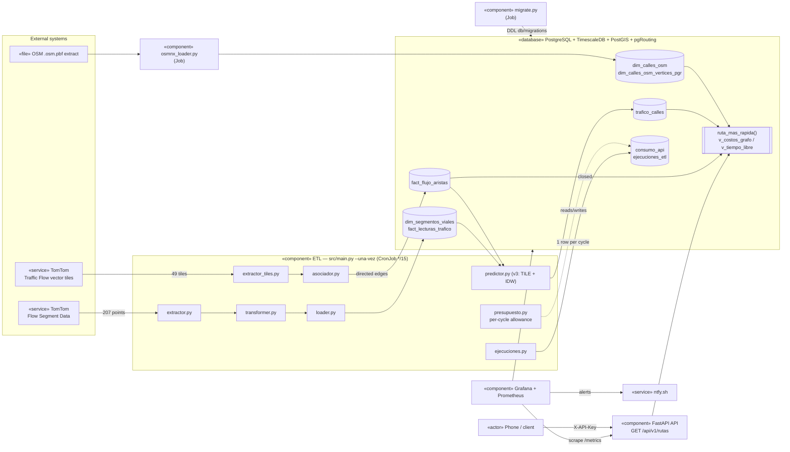
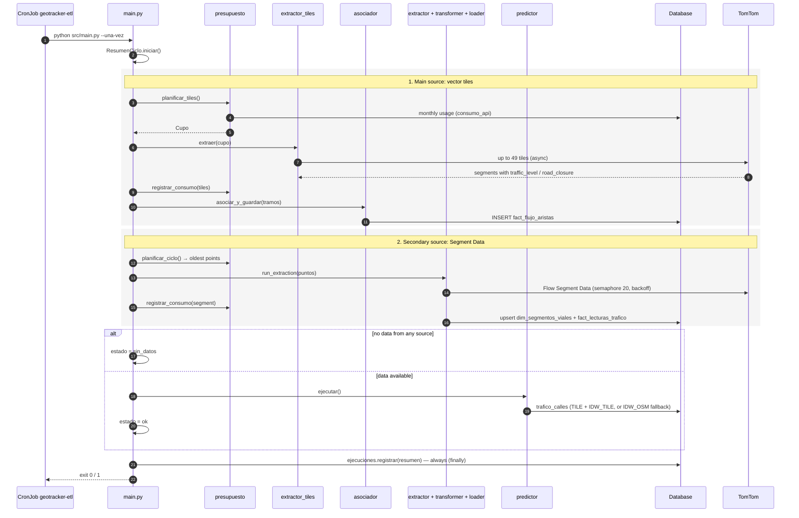

# Architecture and Development Rules — geoTracker

Infrastructure, code and data standards for the traffic ingestion, inference and routing system of
San Luis Potosí. Related documents:

- [`DATABASE.md`](DATABASE.md) — actual database schema and technical debt (P1–P11).
- [`ROUTING.md`](ROUTING.md) — design of Dijkstra routing with traffic.
- [`DECISIONES.md`](DECISIONES.md) — decision log: what changed and why.
- [`KUBERNETES.md`](KUBERNETES.md) — analysis and plan of the Kubernetes deployment milestone.
- [`CLAUDE.md`](../CLAUDE.md) — operational guide (commands, modules).

Each rule is marked with its status: ✅ met · ⚠️ known violation (with reference).

## 0. System overview

1. **Measure** traffic with TomTom: vector tiles as the main source (49 tiles every 15 min) and Flow Segment Data (207 points) as the secondary one, each with its own monthly pool.
2. **Measure and infer** congestion over the whole OSM road network (~67.5 k edges): ~15 k measured by vector tiles, the rest by IDW → heatmap in Grafana.

Both cover the same study area (`src/zona.py`): the San Luis Potosí metropolitan area, including Soledad de
Graciano Sánchez.
3. **Route** (next phase): actual fastest route between the user and a destination using Dijkstra
   (pgRouting) with costs weighted by current congestion.

### Component diagram (UML)

Which pieces exist, which data they exchange, and which tables they write or read. The deployment (pods, nodes,
namespaces) is in `KUBERNETES.md`.

### ETL cycle (UML: sequence)

One `ciclo_etl()` cycle (`src/main.py`). A tile failure does not prevent Segment Data; the cycle always leaves its
row in `ejecuciones_etl`, even when it fails (D41).

## 1. Infrastructure and deployment (Docker)

* **Environment parity:** development and production use Docker Compose exclusively. No global dependencies are installed on the host. ✅
* **Current environment: Kubernetes** (local k3d; manifests in `deploy/k8s/`, see `docs/KUBERNETES.md`). Since D44,
  all Compose services sit behind profiles (`compose`, `etl-compose`, `grafana-compose`) and are stopped;
  the table below describes Compose, which is kept for local tests (e.g. the database for integration tests).
* **Compose services** (`docker-compose.yml`, Compose v2+, network `red_trafico`, all with `restart: unless-stopped` — D17):

  | Service | Container | Image / build | Port |
  |---|---|---|---|
  | `timescaledb` | `trafico_db` | `geotracker-timescaledb:pg15.2-ts2.10.2` (`db/Dockerfile`, base pinned by digest + pgRouting 4.0.1) | 5432 |
  | `etl_worker` | `etl_trafico` | root `Dockerfile` (Python 3.11) | — |
  | `api` | `geotracker_api` | `services/api/Dockerfile` (FastAPI, Python 3.12) | 8000 |
  | `grafana` | `grafana_bi` | `grafana/grafana-oss:13.0.2` | 3000 |

* **Pinned image versions:** no image uses `latest`. The database is **never rebuilt or upgraded** as a side
  effect: changing PostgreSQL/TimescaleDB/PostGIS/pgRouting is a planned migration (backup + test). ✅ (D17)
* **Immutable containers:** no service mounts the repo's code; each runs what was built into its image. ✅ (D17)

* **Database engine:** PostgreSQL 15 with **TimescaleDB + PostGIS + pgRouting**. The image is not changed without updating `DATABASE.md`. ✅
* **Versioned schema:** all DDL (tables, columns, indexes, hypertables, views) lives in `db/migrations/NNN_nombre.sql`, is idempotent and is applied with `src/migrate.py` (automatically when `main.py` starts). An applied migration is never edited: a new one is added. The schema is never changed by hand only. ✅
* **Hypertables:** every history table (`fact_lecturas_trafico`, `trafico_calles`) is turned into a hypertable before receiving data and must have a compression/retention policy. Raw data (`fact_lecturas_trafico`) never expires; derived data does. No process writes into chunks older than 7 days (they may be compressed). ✅
* **Environment variables:** no credentials (database, Grafana, TomTom) in code or in `docker-compose.yml`; everything comes from `.env` (in `.gitignore`) via `${VAR}`. Canonical names: `TOMTOM_API_KEY`, `DB_USER`, `DB_PASSWORD`, `DB_HOST`, `DB_PORT`, `DB_NAME`, `GF_ADMIN_USER`, `GF_ADMIN_PASSWORD`. ✅ (D17)
* **ETL Dockerfile:** a single stage based on `python:3.11.15-slim-trixie` + GDAL/libpq dependencies; it must build without errors (`docker build .`). ✅ (D10)

## 2. Code standards (Python)

* **Modular architecture:** one responsibility per module: `config`, `extractor_tiles` + `asociador` (main source), `extractor` + `transformer` + `loader` (secondary source), `presupuesto`, `predictor` and (upcoming) `router`. Preparation scripts live in `scripts/`. ✅
* **Async network I/O in the ETL:** `aiohttp` + `asyncio`. `requests` is only allowed in one-shot preparation scripts (`scripts/`). ✅
* **Pinned dependencies:** exact version (`==`) in `requirements.txt` and `services/api/requirements.txt`. ✅ in the ETL (D10) and the API (D16).
* **Logging:** `print()` is forbidden outside test `if __name__ == "__main__"` blocks. Use `logging` with level and timestamp; configure `basicConfig` **only** at entry points (`main.py`, scripts), not in modules. ⚠️ `config.py:38`; `basicConfig` repeated in loader/transformer/predictor.
* **Centralized configuration:** shared constants are defined once: the study area in `src/zona.py` (a test prevents defining another `BBOX`), the rest (SRID, intervals, peak hours) in `src/config.py`. ✅

## 3. Communication with external APIs

* **Retries:** on `429` or `5XX`, exponential backoff with jitter (`TOMTOM_TIEMPO_BASE · 2^n + U(0,1)` s, at most `TOMTOM_MAX_REINTENTOS` = 4). Remaining `4XX` errors are fatal for that point. ✅
* **Timeouts:** 10 s per request. ✅
* **Concurrency:** semaphore of `TOMTOM_LIMITE_CONCURRENCIA` = 20. ✅
* **Request economy:** daily usage must fit TomTom's quota. With N points and cycles every M minutes: `N × cycles/day ≤ quota`. The orchestrator must honour `HORAS_PICO` and/or reduce N. No monitoring point may fall outside the study area (`generador_topologia.filtrar_en_zona`) or repeat another point's segment (`deduplicar_puntos.py`). Every call to a metered API goes through `src/presupuesto.py`: a per-cycle allowance derived from the **monthly** quota, weighted by `HORAS_PICO`, counting every HTTP attempt in `consumo_api` and stopping on a 403. ✅

## 4. Data handling

* **Geometry in PostGIS:** all geometry is stored as PostGIS `geometry` with an explicit SRID — `4326` for presentation/routing, `32614` for metric calculations. The JSONB column `coordenadas_geometria` is only a raw backup of TomTom's response; no new process may read it. (Replaces the former "geometry only in JSONB" rule.) ✅
* **Geometry isolation:** fact tables (`fact_lecturas_trafico`, `trafico_calles`) never contain geometry; it is obtained by JOIN with their dimension. ✅
* **API schema validation:** the transformer uses `.get()` and assigns `None` for missing keys; it must not raise `KeyError`. ✅
* **Bulk inserts:** batched writes (`insert().values(list)` or `executemany` in batches ≥ 500). One `INSERT` per row in a loop is forbidden. ✅
* **Idempotency:** every insert uses `ON CONFLICT DO NOTHING` / `DO UPDATE` on a unique constraint. Running a cycle twice does not duplicate data. Timestamps of derived data identify the **source data**, not the time they were computed (e.g. `trafico_calles.timestamp_calculo` = most recent TomTom reading used); otherwise the unique constraint would never detect the duplicate. ✅
* **Stable identifiers:** dimension IDs must be deterministic across runs: never Python's `hash()` or anything that depends on the order of a `set` (osmnx attribute lists change order with `PYTHONHASHSEED`). ✅
* **Congestion:** `nivel_congestion = currentTravelTime / freeFlowTravelTime`; 1.0 = free flow, >1 = congestion; if `freeFlowTravelTime` is 0/None → 1.0.

## 5. Routing (pgRouting)

* The graph is `dim_calles_osm` (edges, `id/source/target`, only `activo`) + `dim_calles_osm_vertices_pgr` (nodes = OSM node IDs), **directed**: always `directed => true` and `reverse_cost = -1`.
* An edge's cost is expressed in **seconds** (travel time with traffic), never in metres, and is computed in a SQL view (`v_costos_grafo`), not in Python. Closed roads are **excluded**, not made more expensive. Every route is obtained with `ruta_mas_rapida()` (D14). ✅
* The network and the topology are regenerated together with `scripts/osmnx_loader.py`, which validates at the end with `pgr_connectedComponents` and edges without a vertex (today: 1 component, 28 008 vertices, 0 orphans).
* Full detail in [`ROUTING.md`](ROUTING.md).

## 6. Testing

* Tests in `tests/` with `pytest`, run with `PYTHONPATH=src`. Every transformation or loading rule must have a test. ✅ (138 green tests as of 2026-11-09). Logic that lives in SQL (spatial matching) is tested against a real PostgreSQL (`tests/test_asociador_db.py`, temporary database).
