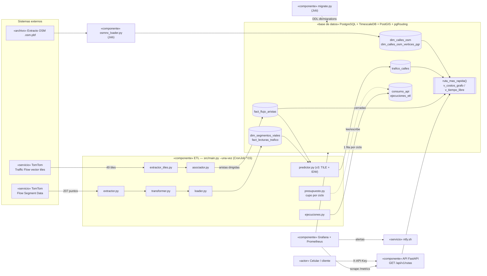
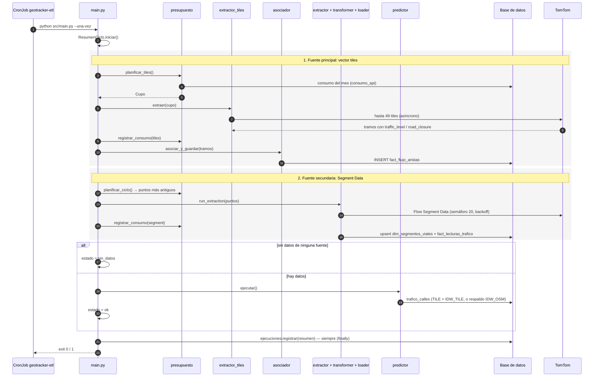

# Reglas de Arquitectura y Desarrollo — geoTracker

Estándares de infraestructura, código y datos del sistema de ingesta, inferencia y ruteo de tráfico
vial de San Luis Potosí. Documentos relacionados:

- [`DATABASE.md`](DATABASE.md) — esquema real de la BD y deuda técnica (P1–P11).
- [`ROUTING.md`](ROUTING.md) — diseño del ruteo con Dijkstra + tráfico.
- [`DECISIONES.md`](DECISIONES.md) — registro de decisiones: qué se cambió y por qué.
- [`KUBERNETES.md`](KUBERNETES.md) — análisis y plan del siguiente milestone (despliegue en Kubernetes).
- [`CLAUDE.md`](../CLAUDE.md) — guía operativa (comandos, módulos).

Cada regla está marcada con su estado: ✅ se cumple · ⚠️ incumplimiento conocido (con referencia).

## 0. Visión del sistema

1. **Medir** el tráfico con TomTom: vector tiles como fuente principal (49 tiles cada 15 min) y Flow Segment Data (207 puntos) como secundaria, cada una con su pool mensual.
2. **Medir e inferir** la congestión en toda la red vial OSM (~67.5 k aristas): ~15 k medidas por vector tiles, el resto por IDW → mapa de calor en Grafana.

Ambos cubren la misma zona de estudio (`src/zona.py`): zona metropolitana de SLP incluida Soledad de
Graciano Sánchez.
3. **Rutear** (próxima fase): ruta más rápida real entre el usuario y un destino usando Dijkstra
   (pgRouting) con costos ponderados por la congestión actual.

### Diagrama de componentes (UML)

Qué piezas hay, qué datos intercambian y en qué tablas escriben o leen. El despliegue (pods, nodos, namespaces)
está en `KUBERNETES.md`.

### Ciclo del ETL (UML: secuencia)

Un ciclo de `ciclo_etl()` (`src/main.py`). Un fallo de tiles no impide Segment Data; el ciclo siempre deja su
fila en `ejecuciones_etl`, aunque falle (D41).

## 1. Infraestructura y despliegue (Docker)

* **Paridad de entornos:** desarrollo y producción usan exclusivamente Docker Compose. No se instalan dependencias globales en el anfitrión. ✅
* **Entorno vigente: Kubernetes** (k3d local; manifiestos en `deploy/k8s/`, ver `docs/KUBERNETES.md`). Desde D44,
  todos los servicios de Compose están detrás de perfiles (`compose`, `etl-compose`, `grafana-compose`) y apagados;
  la tabla siguiente describe Compose, que se conserva para pruebas locales (p. ej. la BD de los tests de integración).
* **Servicios de Compose** (`docker-compose.yml`, Compose v2+, red `red_trafico`, todos con `restart: unless-stopped` — D17):

  | Servicio | Contenedor | Imagen / build | Puerto |
  |---|---|---|---|
  | `timescaledb` | `trafico_db` | `geotracker-timescaledb:pg15.2-ts2.10.2` (`db/Dockerfile`, base fijada por digest + pgRouting 4.0.1) | 5432 |
  | `etl_worker` | `etl_trafico` | `Dockerfile` raíz (Python 3.11) | — |
  | `api` | `geotracker_api` | `services/api/Dockerfile` (FastAPI, Python 3.12) | 8000 |
  | `grafana` | `grafana_bi` | `grafana/grafana-oss:13.0.2` | 3000 |

* **Imágenes con versión fija:** ninguna imagen usa `latest`. La BD **no se reconstruye ni actualiza** como efecto
  secundario: cambiar PostgreSQL/TimescaleDB/PostGIS/pgRouting es una migración planeada (respaldo + prueba). ✅ (D17)
* **Contenedores inmutables:** ningún servicio monta el código del repo; corre lo construido en su imagen. ✅ (D17)

* **Motor de base de datos:** PostgreSQL 15 con **TimescaleDB + PostGIS + pgRouting**. No se cambia de imagen sin actualizar `DATABASE.md`. ✅
* **Esquema versionado:** todo DDL (tablas, columnas, índices, hypertables, vistas) vive en `db/migrations/NNN_nombre.sql`, es idempotente y se aplica con `src/migrate.py` (automático al arrancar `main.py`). Una migración aplicada nunca se edita: se agrega otra. Nunca se modifica el esquema solo a mano. ✅
* **Hypertables:** toda tabla de histórico (`fact_lecturas_trafico`, `trafico_calles`) se convierte en hypertable antes de recibir datos y debe tener política de compresión/retención. Los datos crudos (`fact_lecturas_trafico`) nunca expiran; los derivados sí. Ningún proceso escribe en chunks de más de 7 días (pueden estar comprimidos). ✅
* **Variables de entorno:** ninguna credencial (BD, Grafana, TomTom) en código ni en `docker-compose.yml`; todo viene de `.env` (en `.gitignore`) vía `${VAR}`. Nombres canónicos: `TOMTOM_API_KEY`, `DB_USER`, `DB_PASSWORD`, `DB_HOST`, `DB_PORT`, `DB_NAME`, `GF_ADMIN_USER`, `GF_ADMIN_PASSWORD`. ✅ (D17)
* **Dockerfile del ETL:** una sola etapa basada en `python:3.11.15-slim-trixie` + dependencias de GDAL/libpq; debe construirse sin errores (`docker build .`). ✅ (D10)

## 2. Estándares de código (Python)

* **Arquitectura modular:** responsabilidad única por módulo: `config`, `extractor_tiles` + `asociador` (fuente principal), `extractor` + `transformer` + `loader` (fuente secundaria), `presupuesto`, `predictor` y (próximo) `router`. Los scripts de preparación viven en `scripts/`. ✅
* **E/S de red asíncrona en el ETL:** `aiohttp` + `asyncio`. `requests` solo se permite en scripts de preparación one-shot (`scripts/`). ✅
* **Dependencias fijadas:** versión exacta (`==`) en `requirements.txt` y `services/api/requirements.txt`. ✅ en el ETL (D10) y en la API (D16).
* **Logging:** prohibido `print()` fuera de bloques `if __name__ == "__main__"` de prueba. Usar `logging` con nivel y timestamp; configurar `basicConfig` **solo** en los puntos de entrada (`main.py`, scripts), no en módulos. ⚠️ `config.py:38`; `basicConfig` repetido en loader/transformer/predictor.
* **Configuración centralizada:** constantes compartidas se definen una sola vez: la zona de estudio en `src/zona.py` (un test impide definir otro `BBOX`), el resto (SRID, intervalos, horas pico) en `src/config.py`. ✅

## 3. Comunicación con APIs externas

* **Reintentos:** ante `429` o `5XX`, backoff exponencial con jitter (`TOMTOM_TIEMPO_BASE · 2^n + U(0,1)` s, máximo `TOMTOM_MAX_REINTENTOS` = 4). Errores `4XX` restantes son fatales para ese punto. ✅
* **Timeouts:** 10 s por petición. ✅
* **Concurrencia:** semáforo de `TOMTOM_LIMITE_CONCURRENCIA` = 20. ✅
* **Economía de peticiones:** el consumo diario debe caber en la cuota de TomTom. Con N puntos y ciclos cada M minutos: `N × ciclos/día ≤ cuota`. El orquestador debe respetar `HORAS_PICO` y/o reducir N. Ningún punto de monitoreo puede quedar fuera de la zona de estudio (`generador_topologia.filtrar_en_zona`) ni repetir el segmento de otro (`deduplicar_puntos.py`). Toda llamada a una API con cuota pasa por `src/presupuesto.py`: cupo por ciclo derivado de la cuota **mensual**, ponderado por `HORAS_PICO`, contando cada intento HTTP en `consumo_api` y deteniéndose ante un 403. ✅

## 4. Tratamiento de datos

* **Geometría en PostGIS:** toda geometría se almacena como `geometry` PostGIS con SRID explícito — `4326` para presentación/ruteo, `32614` para cálculos métricos. La columna JSONB `coordenadas_geometria` es solo un respaldo crudo de TomTom; ningún proceso nuevo debe leerla. (Reemplaza la regla anterior de "geometría solo en JSONB".) ✅
* **Aislamiento de geometría:** las tablas de hechos (`fact_lecturas_trafico`, `trafico_calles`) nunca contienen geometría; se obtiene por JOIN con su dimensión. ✅
* **Validación de esquema de la API:** el transformador usa `.get()` y asigna `None` ante claves ausentes; no debe lanzar `KeyError`. ✅
* **Inserción masiva:** escrituras por lotes (`insert().values(lista)` o `executemany` en lotes ≥ 500). Prohibido un `INSERT` por fila en bucle. ✅
* **Idempotencia:** toda inserción usa `ON CONFLICT DO NOTHING` / `DO UPDATE` sobre una restricción única. Ejecutar un ciclo dos veces no duplica datos. Los timestamps de datos derivados identifican los **datos de origen**, no la hora en que se calcularon (p. ej. `trafico_calles.timestamp_calculo` = lectura TomTom más reciente usada); si no, la restricción única nunca detectaría el duplicado. ✅
* **Identificadores estables:** los IDs de dimensiones deben ser deterministas entre ejecuciones: nunca `hash()` de Python ni nada que dependa del orden de un `set` (las listas de atributos de osmnx cambian de orden con `PYTHONHASHSEED`). ✅
* **Congestión:** `nivel_congestion = currentTravelTime / freeFlowTravelTime`; 1.0 = flujo libre, >1 = congestión; si `freeFlowTravelTime` es 0/None → 1.0.

## 5. Ruteo (pgRouting)

* El grafo es `dim_calles_osm` (aristas, `id/source/target`, solo `activo`) + `dim_calles_osm_vertices_pgr` (nodos = IDs de nodo OSM), **dirigido**: siempre `directed => true` y `reverse_cost = -1`.
* El costo de una arista se expresa en **segundos** (tiempo de recorrido con tráfico), nunca en metros, y se calcula en una vista SQL (`v_costos_grafo`), no en Python. Las vías cerradas se **excluyen**, no se encarecen. Toda ruta se obtiene con `ruta_mas_rapida()` (D14). ✅
* La red y la topología se regeneran juntas con `scripts/osmnx_loader.py`, que valida al final con `pgr_connectedComponents` y aristas sin vértice (hoy: 1 componente, 28 008 vértices, 0 huérfanas).
* Detalle completo en [`ROUTING.md`](ROUTING.md).

## 6. Pruebas

* Tests en `tests/` con `pytest`, ejecutados con `PYTHONPATH=src`. Toda regla de transformación o carga debe tener test. ✅ (138 tests en verde al 2026-11-09). La lógica que vive en SQL (asociación espacial) se prueba contra PostgreSQL real (`tests/test_asociador_db.py`, BD temporal).
