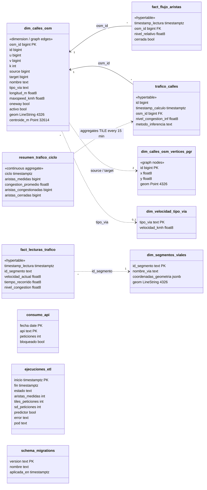

# Database Schema — geoTracker

> **Current database: `geotracker-db-0` in the cluster** (same image and migrations). `trafico_db` (Compose) has been
> retired since 2026-11-20 (D44); its history was copied to the cluster (D43).
>
> Document surveyed **against the real database** (`trafico_db`, database `vialidades_slp`) on 2026-11-09
> and updated after applying migrations 001–012 and expanding the OSM network to the single study area the same day.
> Engine: pinned image `geotracker-timescaledb:pg15.2-ts2.10.2` (D17).
> The full DDL lives in `db/migrations/`; if you change the schema, add a migration and update
> this file in the same commit.

## Engine and extensions

Image: `geotracker-timescaledb:pg15.2-ts2.10.2` = `timescale/timescaledb-ha` pinned by digest (the 2023
`pg15-latest`, PostgreSQL 15.2) + `postgresql-15-pgrouting=4.0.1` (see `db/Dockerfile`, D17). Do not use `pg15-latest`:
today it ships a TimescaleDB that cannot load this data without upgrading the extension.

| Extension | Version | Use |
|---|---|---|
| `postgis` | 3.3.2 | Geometries (`geometry`), GiST indexes, reprojection |
| `pgrouting` | 4.0.1 | Road graph and Dijkstra (`pgr_dijkstra`, `pgr_connectedComponents`) |
| `timescaledb` | 2.10.2 | Hypertables for time series |
| `timescaledb_toolkit` | 1.16.0 | Installed, currently unused |

Reference systems used:
- **EPSG:4326** (WGS84, degrees): all "presentation" geometry (`geom`) — what Grafana and pgRouting consume.
- **EPSG:32614** (UTM 14N, metres): distance calculations (IDW, sampling). Only in `dim_calles_osm.centroide_m`.

## Logical diagram (UML: classes)

Current schema (migrations 001–015, cluster database). Solid line = real FK; dashed = logical relation without
FK. `«hypertable»` = TimescaleDB table partitioned by time. `trafico_inferido` (legacy, P10) is not shown:
it does not exist in the cluster.

Sizes and row counts of each table: in its section below.

## Tables

### `dim_segmentos_viales` — dimension of segments measured by TomTom
| Column | Type | Notes |
|---|---|---|
| `id_segmento` | `text` PK | Key from `data/vialidades_maestras.json` (e.g. `Avenida_Universidad_1`) |
| `nombre_via` | `text` NOT NULL | Currently identical to `id_segmento` |
| `coordenadas_geometria` | `jsonb` | `[{latitude, longitude}, ...]` list returned by TomTom. **Legacy**, kept as a backup |
| `geom` | `geometry(LineString,4326)` | PostGIS geometry. GiST index `idx_segmentos_geom` |

Status: 482 rows, **all with `geom`** (migration 003 filled in the 282 missing ones from the JSONB).
`loader.py` writes `geom` on every upsert: it inserts new segments and completes the geometry of
those that had it NULL. An existing geometry is never overwritten.
35 of these segments ended up outside the study area (P9) and another 233 were redundant (they returned the
same TomTom segment as another point; `scripts/deduplicar_puntos.py`). Today 207 are measured; the rest are
kept for their history in `fact_lecturas_trafico`.

### `fact_lecturas_trafico` — traffic facts (hypertable on `timestamp_lectura`)
| Column | Type | Notes |
|---|---|---|
| `timestamp_lectura` | `timestamptz` NOT NULL | UTC |
| `id_segmento` | `text` NOT NULL | Logical reference to `dim_segmentos_viales` (no FK) |
| `velocidad_actual` | `double precision` | `currentSpeed` km/h |
| `tiempo_recorrido` | `double precision` | `currentTravelTime` s |
| `nivel_congestion` | `double precision` | `currentTravelTime / freeFlowTravelTime` (1.0 = free flow; observed 0–8, mean 1.14) |

Constraint `uq_lectura_por_calle UNIQUE (timestamp_lectura, id_segmento)` → idempotency.
Data: 17 030 rows, 2026-06-10 → 2026-07-01. 7-day chunks. Compression after 7 days
(`segmentby id_segmento`, `orderby timestamp_lectura DESC`). **No retention**: this is the raw data and
the basis for historical costs by time of day.

### `fact_flujo_aristas` — traffic measured per edge from vector tiles (hypertable, migration 010)
| Column | Type | Notes |
|---|---|---|
| `timestamp_lectura` | `timestamptz` NOT NULL | Start of the tile pass (UTC, to the second) |
| `osm_id` | `bigint` NOT NULL FK → `dim_calles_osm` | Measured directed edge |
| `nivel_relativo` | `double precision` NOT NULL, 0..1 | TomTom's `traffic_level` = current / free speed. Equivalent congestion = 1 / level |
| `cerrada` | `boolean` NOT NULL | The tile's `road_closure` |

`UNIQUE (timestamp_lectura, osm_id)`; 1-day chunks; compression after 7 days (`segmentby osm_id`); **no
retention** (raw data, D5). Written by `src/asociador.py` (directed rule, D9/D11). Volume: ~15 000
rows per pass (primary/trunk/motorway ~100 %, secondary 98 %, tertiary 84 %, residential 8 %).
The tile geometry is not stored.

### `dim_calles_osm` — full OSM road network (graph edges)
| Column | Type | Notes |
|---|---|---|
| `osm_id` | `bigint` PK | Stable ID: `blake2b("u_v_k")` (63 bits). In the cluster this holds for the whole network. In the Compose database, the 24 574 rows loaded before 2026-11-09 keep their original ID; when that history was brought into the cluster it was translated by `(u,v,k)` (D43) |
| `u`, `v`, `k` | `bigint`, `bigint`, `integer` | **Natural key** (unique `uq_calles_osm_uvk`): start OSM node, end OSM node, parallel edge index |
| `id` | `bigint` NOT NULL, serial | Edge ID for pgRouting |
| `nombre` | `text` | NULL if unnamed. If OSM has several, the first in alphabetical order is stored |
| `tipo_via` | `text` NOT NULL | OSM `highway`. If the edge merges several types, the highest-ranked one is stored |
| `longitud_m` | `double precision` | Length in metres (osmnx) |
| `maxspeed_kmh` | `double precision` | OSM limit in km/h (sparse: ~1 500 edges) |
| `oneway` | `boolean` | One-way according to OSM |
| `activo` | `boolean` NOT NULL default TRUE | FALSE if the edge no longer exists in the latest OSM download. Not deleted because `trafico_calles` references it |
| `geom` | `geometry(LineString,4326)` | **The line's direction is the direction of travel** |
| `centroide_m` | `geometry(Point,32614)` | Precomputed for IDW |
| `source`, `target` | `bigint` | = `u`, `v` (OSM node IDs) → `dim_calles_osm_vertices_pgr.id`. NULL if `activo = FALSE` |

Indexes: GiST on `geom` and `centroide_m`; btree on `tipo_via`, `source`, `target`, `activo`; unique on `(u, v, k)`.

Data: 67 464 active edges (54 588 residential) in the single area of `src/zona.py`, 28 008 vertices,
**1 single connected component**. Until 2026-11-09 the network only covered the centre (24 574 edges); when it
was expanded, those edges kept their `osm_id` and 42 890 were added.

Loading: `scripts/osmnx_loader.py` does everything in one transaction: staging → adoption of old rows by
geometry → upsert by `(u, v, k)` → deactivation of vanished edges → vertex synchronization
→ validation (edges without vertex = 0; connected components). It is idempotent; verified with three
different `PYTHONHASHSEED` values.

**Directionality:** it comes from a directed osmnx graph (`network_type="drive"`). A two-way street
appears as **two edges** with reversed geometry (in the original network, 17 491 of
24 574 edges had a reverse pair);
a one-way street appears as **one** edge. Therefore Dijkstra must use
`directed => true` and `reverse_cost = -1`. Using `reverse_cost = cost` would allow driving against traffic.

### `dim_calles_osm_vertices_pgr` — graph nodes (intersections)
| Column | Type |
|---|---|
| `id` | `bigint` PK — OSM node ID |
| `x`, `y` | `double precision` (lon/lat) |
| `geom` | `geometry(Point,4326)`, GiST index `idx_vertices_geom` |

Maintained by `osmnx_loader.py` from the osmnx nodes: it only contains nodes used by active
edges. The nearest node to a coordinate is obtained with `ORDER BY geom <-> point LIMIT 1`, which
uses the GiST index. The `in_edges`/`out_edges` columns of `pgr_extractVertices` were removed
(migration 005): they are derived from `dim_calles_osm`.

### `consumo_api` — external API usage (migration 009)
| Column | Type | Notes |
|---|---|---|
| `fecha` | `date` | Day in SLP local time (PK with `api`) |
| `api` | `text` | `tomtom_flow_segment` (secondary source) or `tomtom_flow_vector_tiles` (main source) |
| `peticiones` | `integer` | Every HTTP attempt, retries included |
| `bloqueado` | `boolean` | A 403 was received that day: no more calls until the next one |

Written and read by `src/presupuesto.py` so as not to exceed the monthly quota (see `docs/ROUTING.md` › Traffic sources).

### Routing (migration 011)
- `dim_velocidad_tipo_via (tipo_via PK, velocidad_kmh)` — free-flow speed per road type (12 types).
- View `v_tiempo_libre (osm_id, id, segundos_libre)` — free-flow time of each edge (migration 012).
- View `v_costos_grafo (id, source, target, cost, reverse_cost)` — `segundos_libre × congestion` from the latest
  cycle; excludes inactive edges, self-loops and closed ones.
- Function `ruta_mas_rapida(lat_o, lon_o, lat_d, lon_d)` — see `ROUTING.md`.

### `schema_migrations` — migration control
`version` (PK, `'001'`…), `nombre`, `aplicada_en`. Written by `src/migrate.py`.

### `trafico_calles` — congestion inferred per OSM street (hypertable on `timestamp_calculo`)
| Column | Type | Notes |
|---|---|---|
| `id` | `bigint` serial | No PK |
| `timestamp_calculo` | `timestamptz` NOT NULL | **State of the inferred traffic**: the most recent TomTom reading used (`max(timestamp_lectura)`). Until 2026-07-01 it was the computation time |
| `osm_id` | `bigint` NOT NULL FK → `dim_calles_osm(osm_id)` | |
| `nivel_congestion_inf` | `double precision` NOT NULL | Current time / free time. v3: [1, 10]; v2 (IDW_OSM): [1, 3] |
| `metodo_inferencia` | `text` default `'IDW_OSM'` | `TILE` = direct measurement (vector tiles); `IDW_TILE` = inferred from measured edges; `IDW_OSM` = v2 from Segment Data (fallback) |

Constraint `uq_trafico_calles_ciclo UNIQUE (timestamp_calculo, osm_id)` (migration 006). `predictor.py`
does not recompute if that traffic state already exists, and inserts with `ON CONFLICT ... DO NOTHING`. Re-running it
on the same data does not duplicate rows (verified on a copy of the database).

Indexes: `trafico_calles_timestamp_calculo_idx` (btree `timestamp_calculo DESC`, the one TimescaleDB creates
by default) and the unique `uq_trafico_calles_ciclo`.

Volume and lifecycle (migration 008): with the expanded network there are ~67 k rows per cycle (~6.5 M/day with
cycles every 15 min). **1-day** chunks (those before the change are 7-day), **compression** after 7 days
(`segmentby osm_id`, `orderby timestamp_calculo DESC`; on the test copy 45 MB → 31 MB) and
**365-day retention**. Since TimescaleDB 2.10 does not support `ON CONFLICT` on compressed chunks,
`predictor.py` does not infer if the most recent reading is older than 7 days (`ANTIGUEDAD_MAXIMA`).

Source of each cycle (D13): v3 uses the latest `fact_flujo_aristas` pass from the last 30 min and its
`timestamp_lectura` as `timestamp_calculo` (~15 k `TILE` rows + ~52 k `IDW_TILE`). If there is no recent
pass, v2 uses Segment Data from the last 6 h (`VENTANA_LECTURAS`) with `IDW_OSM`.

Data: 442 332 rows in 18 cycles (2026-06-17 → 2026-07-01).

### `resumen_trafico_ciclo` — per-cycle summary of measured edges (continuous aggregate, migration 014)
Over `trafico_calles` with `metodo_inferencia = 'TILE'`, in 15-minute buckets (`ciclo`): `aristas_medidas`,
`congestion_promedio`, `aristas_congestionadas` (≥ 1.3, closed ones included) and `aristas_cerradas` (≥ 9.99). Feeds
panel 1 of the dashboard (D38). `materialized_only = false`: the not-yet-materialized cycle is computed live.
Refresh policy every 15 min over the last 7 days (= `compress_after`); an older restored history
is refreshed by hand, **outside a transaction**:
`CALL refresh_continuous_aggregate('resumen_trafico_ciclo', NULL, now() - INTERVAL '7 days');`
Cost: 90 cycles in ~30 ms (aggregating `trafico_calles` directly: ~8 s).

### `ejecuciones_etl` — one row per ETL cycle (migration 015)
| Column | Type | Notes |
|---|---|---|
| `inicio` | `timestamptz` PK | Cycle start (UTC); idempotency (`ON CONFLICT DO NOTHING`) |
| `fin`, `duracion_s` | `timestamptz`, `double precision` | `duracion_s` generated (`fin − inicio`) |
| `estado` | `text` CHECK | `ok` (measured and ran the predictor), `sin_datos` (no source returned data), `error` (exception; the Job exits with 1) |
| `aristas_medidas` | `integer` | Edges matched from tiles (0 if the pass failed or there was no allowance) |
| `tiles_peticiones`, `tiles_bloqueado` | `integer`, `boolean` | Usage of the pass and whether there was a 403 |
| `sd_peticiones`, `sd_bloqueado`, `sd_cargado` | `integer`, `boolean`, `boolean` | Segment Data |
| `predictor` | `boolean` | Whether the predictor ran |
| `error` | `text` | Exceptions, including absorbed ones (tile failure with Segment Data as fallback); max. 2000 characters |
| `pod` | `text` | Pod `HOSTNAME` → `kubectl logs` |

Written by `src/ejecuciones.py` from `main.ciclo_etl`, even if the cycle fails; if saving it fails, the cycle
carries on. Regular table (~96 rows/day). Read by the "ETL: últimos ciclos" panel and the "ETL sin datos de tiles" alert (D41).

### `trafico_inferido` — **LEGACY** (IDW v1 over a point grid)
`id`, `timestamp_calculo`, `segmento_origen_id` (FK → `dim_segmentos_viales`), `nivel_congestion_inf`,
`distancia_metros`, `metodo_inferencia` (`IDW_GRID`), `lat`, `lon`.
152 834 rows, last data 2026-06-17. Not a hypertable. No longer written. **Retired (P10, D44):** it only exists in
the Compose database, which is stopped; it was not copied to the cluster (D43) and the versioned dashboard (D33) reads `trafico_calles`. It
is kept in the `geotracker_datos_postgres` volume for as long as that volume exists.

## Migrations (`db/migrations/`)

`src/migrate.py` applies them in order, each in its own transaction, and records them in
`schema_migrations`. `main.py` calls it on startup. All are idempotent: they were verified on the
existing database and on an empty one.

| Version | Content |
|---|---|
| 001 | Extensions `timescaledb`, `postgis`, `pgrouting` |
| 002 | Baseline: the system's 5 tables, indexes and hypertables (what used to be manual SQL) |
| 003 | (P2) Backfill of `dim_segmentos_viales.geom` from the JSONB |
| 004 | (P3/P4) `u, v, k, maxspeed_kmh, oneway, activo` + unique `(u, v, k)`; cleans `nombre = 'NaN'` |
| 005 | (P5) PK and GiST index on vertices; types `geom` as `Point,4326`; drops `in_edges/out_edges` |
| 006 | (P6) `UNIQUE (timestamp_calculo, osm_id)` on `trafico_calles` |
| 007 | (P7) Drops the duplicate index `idx_trafico_calles_tiempo` |
| 008 | (P8) Compression after 7 days on both hypertables; 365-day retention on `trafico_calles`; daily chunks on `trafico_calles` |
| 009 | Table `consumo_api` (TomTom request pool) |
| 010 | Hypertable `fact_flujo_aristas` (traffic per edge from vector tiles) |
| 011 | Routing: `dim_velocidad_tipo_via`, view `v_costos_grafo`, function `ruta_mas_rapida()` (see `ROUTING.md`) |
| 012 | View `v_tiempo_libre` (free-flow seconds per edge); `v_costos_grafo` now uses it (D16) |
| 013 | Role `grafana_ro` (read-only) for Grafana: `SELECT` on `public` + default privileges for future tables, `statement_timeout = 30s`, at most 10 connections. Created `NOLOGIN`; `migrate.py` assigns it a password and login if it receives `GRAFANA_DB_PASSWORD` (D33) |
| 014 | Continuous aggregate `resumen_trafico_ciclo` (measured edges per cycle) + 7-day refresh policy. Created `WITH NO DATA` so it can run inside `migrate.py`'s transaction (D38) |
| 015 | Table `ejecuciones_etl`: one row per ETL cycle (status, edges, requests, error, pod) (D41) |

`trafico_inferido` (legacy) is not in the migrations: it only exists in the Compose database (not in the cluster's).

### Roles
| Role | Use | Permissions |
|---|---|---|
| `user` | Schema owner: ETL, API, migrations | All |
| `grafana_ro` | Grafana's TimescaleDB datasource (D33) | Only `SELECT` on `public` (including tables created later); queries cut off at 30 s |

Roles are global to the PostgreSQL server, not to the database.

## Known issues (schema technical debt)

| # | Issue | Impact | Proposed action |
|---|---|---|---|
| P1 | ✅ **Resolved** — DDL outside the repo | — | Migrations 001–005 + `src/migrate.py` |
| P2 | ✅ **Resolved** — `loader.py` did not write `geom` | — | Migration 003 + `transformer.coordenadas_a_wkt` + upsert with `ST_GeomFromText` |
| P3 | ✅ **Resolved** — `osm_id` with random `hash()` | — | Natural key `(u, v, k)` + `blake2b` + adoption of old rows (24 574/24 574 kept their `osm_id`). Reading osmnx lists, whose order depended on `PYTHONHASHSEED`, was also fixed |
| P4 | ✅ **Resolved** — topology rebuilt by hand, without `maxspeed` | — | `source/target = u/v`; vertices from OSM nodes; `maxspeed_kmh`, `oneway` |
| P5 | ✅ **Resolved** — vertices without PK or GiST | — | Migration 005; the nearest node uses `Index Scan using idx_vertices_geom` |
| P6 | ✅ **Resolved** — `trafico_calles` without uniqueness | — | Migration 006; `timestamp_calculo` = cycle reference; `ON CONFLICT DO NOTHING` + skipping already inferred cycles |
| P7 | ✅ **Resolved** — duplicate index on `trafico_calles` | — | Migration 007 (~2.9 MB freed; no exact duplicates in the whole database) |
| P8 | ✅ **Resolved** — no compression/retention | — | Migration 008; TimescaleDB jobs 1000–1002 |
| P9 | ✅ **Resolved** — three different BBOXes (302 of 475 TomTom points outside the OSM network) | — | Single area in `src/zona.py` (the wide one, includes Soledad); OSM network expanded to 67 464 edges; 35 TomTom points that were outside the whole area removed (475 → 440) and a filter in `generador_topologia.py` |
| P10 | ✅ `trafico_inferido` obsolete | Noise in the schema | **Resolved (D44):** it does not exist in the cluster and was not copied (D43); the Grafana (D35) and the Compose database (D44) that held it are retired. It only remains in the preserved Compose volume |
| P11 | ✅ **Resolved in routing** — self-loops (`source = target`) in `dim_calles_osm` (29 in the original network); `v_costos_grafo` excludes them. They remain in the table (harmless) | — | Migration 011 |
