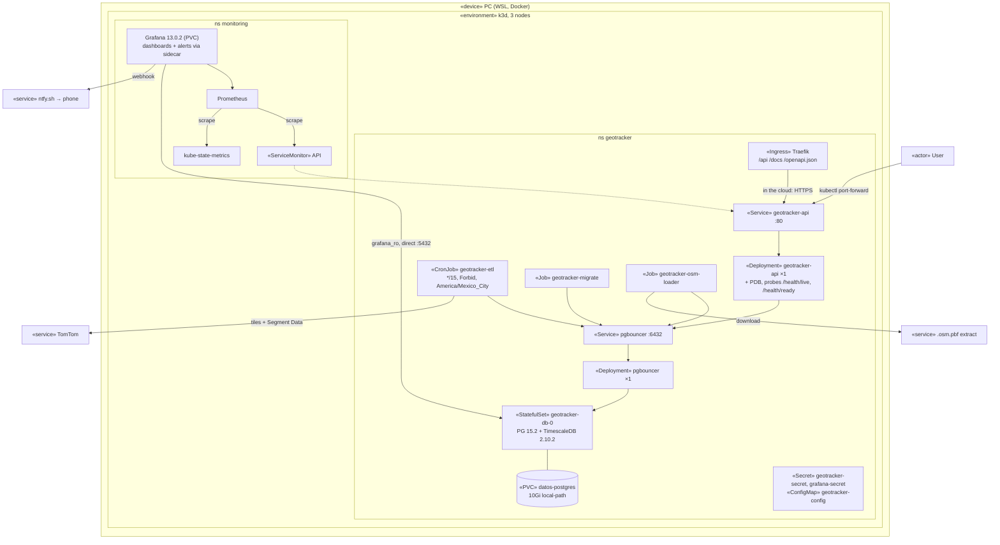
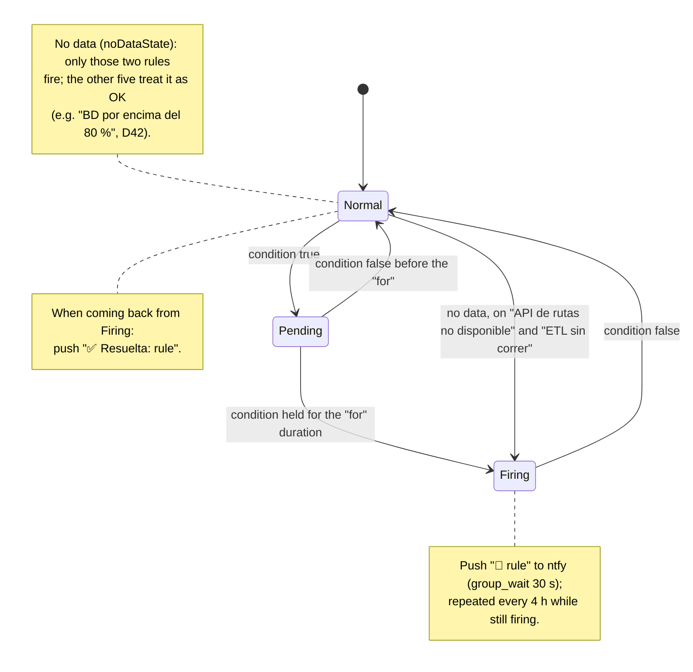

# Kubernetes — milestone plan and implementation

> **Current status (2026-11-27):** phases 1, 3 (except `postgres_exporter`) and 4 are done on local k3d. Phase 2
> (Azure) has a draft design and a plan for its first stage in `docs/superpowers/`, with no implementation yet.
> CI/CD has not been started. The dated notes below are history: each one describes its own date.

> **Update 2026-11-20:** phase 4 done (D43). The Compose history (since 2026-06) is in the cluster,
> translated to its `osm_id`s and verified against Compose; see "Data migration". Compose retired: database and API
> stopped and all its services behind profiles (D44). Next: phase 2 (cloud) and the CI/CD decision.

> **Update 2026-11-17:** alerts as code: the 5 initial ones + "ETL sin datos de tiles" (D40, D41); table
> `ejecuciones_etl` (D41); dashboard rebuilt on tile data (D36–D38, D40) and PostgreSQL memory matched to the
> pod limit (D39). Still missing: a contact point that notifies outside Grafana, `postgres_exporter` and the
> history (phase 4).
>
> **Update 2026-11-14:** phase 3 in progress on k3d. Prometheus + Grafana (`kube-prometheus-stack`), dashboards
> as code, the `grafana_ro` role and the scraped API are in place (D31–D33); see "Observability: operations".
> Still missing: `ejecuciones_etl`, the alert rules and the history (phase 4).
>
> **Update 2026-11-13:** phase 1 applied on k3d (D28, D29): database, PgBouncer, API with token, migrations and
> OSM network loaded; the ETL runs as a `CronJob` and the Compose one is stopped. Missing: history and Grafana (phase 4).
>
> **Update 2026-11-12** (superseded: applied on 2026-11-13): phase 1 in implementation. The earlier analysis
> (2026-11-09) is kept below as background. The decisions that were **open** were taken in this session and are
> reflected here and in `docs/DECISIONES.md` (D19–D23). The `base` + `overlays/local` manifests already exist:
> they render with `kubectl kustomize` and pass `kubectl apply -k --dry-run=client --validate=strict` against the
> k3d cluster (13 objects, 2026-11-12). Not applied on that date. The `--una-vez` mode already existed (D24);
> before applying, `geotracker-etl:latest` had to be rebuilt and imported into k3d. `overlays/nube` does not exist
> yet (phase 2).

## Goal

Deploy geoTracker (database, ETL, API, Grafana) on Kubernetes, with **local / cloud duality**: the same
manifests must be able to run on a local cluster (development) and on a managed one in the cloud (production).
Two concrete goals drive the design:

1. **Redundancy / fault tolerance**: the loss of a pod, a node or a new rollout must not leave the
   service unresponsive.
2. **Multi-user traffic handling**: spread the load of many requests across several replicas so that
   none is a single bottleneck.

## Where the manifests live

Everything deployment-related lives in `deploy/` at the repo root, versioned with the code it deploys (the
manifest for version X of the API travels in the same commit as that version X):

```
geoTracker/
├── docker-compose.yml          # the Compose stack still exists (quick development)
├── db/ src/ scripts/ ...        # current code
├── docs/
│   ├── DECISIONES.md
│   └── KUBERNETES.md            # this document
└── deploy/
    ├── k8s/
    │   ├── base/                # manifests shared by local and cloud + kustomization.yaml
    │   │   ├── 00-namespace.yaml
    │   │   ├── 01-configmap.yaml
    │   │   ├── 03-database-statefulset.yaml   # database option A (local, phase 1)
    │   │   ├── 03b-database-cnpg.yaml         # database option B (CloudNativePG, phase 2)
    │   │   ├── 04-pgbouncer.yaml
    │   │   ├── 05-api.yaml               # Deployment + Service + PodDisruptionBudget
    │   │   ├── 06-etl-cronjob.yaml
    │   │   ├── 07-migrations-job.yaml
    │   │   ├── 08-ingress.yaml
    │   │   ├── 09-osm-loader-job.yaml     # OSM network from a .osm.pbf extract (D29, D30)
    │   │   └── kustomization.yaml
    │   ├── platform/            # observability (D31–D33)
    │   │   ├── kube-prometheus-stack/   # the chart's values.yaml + values-local.yaml (Helm)
    │   │   ├── grafana/dashboards/      # JSON dashboards → ConfigMaps
    │   │   ├── servicemonitor-api.yaml
    │   │   └── kustomization.yaml       # included by the overlays
    │   └── overlays/
    │       ├── local/           # 1 replica, patches; Secrets from secret.env and grafana.env (outside git, D27, D33)
    │       └── nube/            # ≥ 2 replicas, Ingress + TLS + token, Azure StorageClass (phase 2)
    ├── terraform/               # (phase 2) Azure infrastructure
    └── ansible/                 # (phase 2, if applicable) host preparation / TimescaleDB upgrade
```

Each tool manages **a single domain** (D18): Terraform creates the cluster and the network; Kustomize deploys
the apps; Ansible prepares hosts and operational tasks. They do not step on each other.

## Analysis conclusion

**It is possible and feasible.** The project already meets most of the requirements of a Kubernetes
application thanks to decisions from the `feat/ruteo-dijkstra-postgis` branch:

| Kubernetes requirement | Current status | Where |
|---|---|---|
| Reproducible images with pinned versions | ✅ | D10, D17 |
| Immutable containers (no mounted code) | ✅ | D17 |
| Configuration via environment variables | ✅ (`.env` → `Secret`/`ConfigMap`) | D17, phase 1 |
| Versioned schema, idempotently applicable | ✅ `db/migrations` + `migrate.py` | D2 |
| Idempotent processes (repeating a cycle does not duplicate) | ✅ | D4, P6 |
| State outside the process (quotas in the database, not in memory) | ✅ `consumo_api` | D7 |
| API health probe | ✅ `/health` | D16 |
| Logs to stdout | ✅ | — |

**The hard part is the database** (its own section below). **The real cost is operational**: at the current scale
(one city, ~12 s ETL cycle every 15 min, a light API) Compose is enough; Kubernetes is justified
by learning/portfolio, growth (several cities, more API traffic) or high availability.

## Decisions taken in this session (previously open)

These close the questions at the end of the document and are recorded in `DECISIONES.md`:

- **Local → cloud order** (question 1): local first to learn without burning credit; cloud afterwards.
- **Cloud provider** (question 2): **Azure** (AKS), taking advantage of $100 USD of free credit. Budget:
  the credit; measure usage in phase 2, shut the cluster down when not in use.
- **Database** (question 3): **option A (StatefulSet) locally for phase 1; option B (CloudNativePG)
  in phase 2**. The TimescaleDB 2.10.2 upgrade is evaluated as a phase 2 prerequisite, not "along the way".
- **Kustomize, not Helm** (question 4): `base` + overlays; simpler to learn and template-free.
- **Non-public API, restricted access** (question 5): not published in any store. In the cloud, access is
  limited to own devices by **token** (a header the API validates) over TLS, with no IP restriction (D49).
  This keeps the project on the safe side of D8 (research/development use, no public redistribution).
- **Additions to the original design** (confirmed against both goals):
  - **PgBouncer as its own Deployment**: avoids exhausting `max_connections` with several API replicas + ETL.
  - **PodDisruptionBudget (`minAvailable: 1`)**: guarantees a node drain never takes the API to zero.
  - **topologySpreadConstraints**: spreads the API replicas across different nodes.
- **Local cluster: k3d** (question 7): on Docker, no VMs; Terraform/Ansible are reserved for the cloud.

Still **open** for later phases: CI/CD Jenkins vs GitHub Actions (question 6) and Terraform details
and remote `tfstate` (question 8; proposed in the phase 2 draft design). Grafana and Pushgateway (question 9) and the
alerting engine were decided in D31; the alert channel (question 10), ntfy, in D42.

## Measured baseline (Compose, 2026-11-09)

Data to size `requests`/`limits` and volumes. Measure again with several days of data.

| Component | Idle memory | Idle CPU | Image | Notes |
|---|---|---|---|---|
| Database (`trafico_db`) | ~364 MiB | ~3 % | 4.53 GB | 307 MB of data after 1 day with tiles |
| ETL (`etl_trafico`) | ~153 MiB | ~0 % (spikes during the cycle) | 2.27 GB | ~12 s cycle every 15 min; predictor with 67 k streets |
| API (`geotracker_api`) | ~131 MiB | <1 % | 302 MB | Route in ~0.3 s (pgr_dijkstra loads the graph per request) |
| Grafana (`grafana_bi`) | ~125 MiB | ~1 % | 1.47 GB | — |

The manifests' `requests`/`limits` come from this table, with headroom for the predictor's spikes.

Estimated data growth (to be verified): `trafico_calles` ~6.5 M rows/day and `fact_flujo_aristas`
~1.4 M rows/day before compression (after 7 days). With 1 day: `trafico_calles` 113 MB, `fact_flujo_aristas` 13 MB.

## Component mapping (implemented in `deploy/k8s/base`)

| Component | Kubernetes resource | File | Notes |
|---|---|---|---|
| API | `Deployment` (3 replicas in base, 1 locally) + `Service` + `PodDisruptionBudget` | `05-api.yaml` | Readiness on `/health/ready`, liveness on `/health/live` (D32). Spread across nodes. HPA candidate |
| Pooler | `Deployment` (2 replicas) + `Service` | `04-pgbouncer.yaml` | All database traffic goes through here (port 6432) |
| ETL | `CronJob` `*/15`, `Forbid`, `timeZone: America/Mexico_City` | `06-etl-cronjob.yaml` | Replaces the `while True`. `Forbid` = never a double quota |
| Migrations | Explicit `Job` (not an initContainer) | `07-migrations-job.yaml` | Runs once before the app; avoids races between replicas |
| Database | `StatefulSet` + PVC (phase 1) → CloudNativePG operator (phase 2) | `03` / `03b` | See "Database" below |
| `.env` | `Secret` + `ConfigMap` | `01` / `02` | Non-sensitive config in a ConfigMap; credentials in a Secret |
| Entry point | `Ingress` | `08-ingress.yaml` | Traefik locally; TLS + token in phase 2 |
| OSM network load | `Job` (`osmnx_loader.py`) | `09-osm-loader-job.yaml` | Waits for migrations ≥ 005. Reads a `.osm.pbf` extract (`OSM_PBF_URL`), not Overpass (D30); needs internet egress |
| Grafana + Prometheus | `kube-prometheus-stack` chart (Helm), namespace `monitoring` | `platform/kube-prometheus-stack/` | Grafana 13.0.2 with PVC; TimescaleDB (`grafana_ro`) and Prometheus datasources (D33) |
| Dashboards + ServiceMonitor | One `ConfigMap` per dashboard + `ServiceMonitor` | `platform/kustomization.yaml` | Included by the overlay; requires the chart's CRDs |
| Backups | `CronJob` with `pg_dump` | (pending) | Manual today; with the operator in phase 2 |

### Current local deployment (UML: deployment)

k3d cluster `geotracker` (1 server + 2 agents, fixed IPs D34) on Docker in WSL. Pods are not pinned to a
node: the diagram groups by namespace. The Azure target is in
`docs/superpowers/specs/2026-11-20-fase2-azure-aks-design.md`.



### Alert lifecycle (UML: states)

How a Grafana rule evolves (D40–D42). The daily case: when the computer is switched on, "ETL sin correr" goes to
*Firing* and resolves itself after the first cycle.



## Database — decision taken (A → B)

Current engine: our own pinned image `geotracker-timescaledb:pg15.2-ts2.10.2` (PostgreSQL 15.2, TimescaleDB 2.10.2,
PostGIS 3.3.2, pgRouting 4.0.1 — D17). This combination is **not** offered as-is by the usual managed
services, which is why option C (managed database) was discarded.

| Option | Pros | Cons | Use |
|---|---|---|---|
| A. Plain `StatefulSet` with our own image | Same locally and in the cloud; full control over extensions | Single point of failure; own backups/failover | **Phase 1 (local)** |
| B. CloudNativePG operator with our own image | Managed replicas, failover and backups; two automatic read/write Services | Requires a compatible image; validate TimescaleDB + pgRouting | **Phase 2 (cloud)** |
| C. Database outside the cluster | Kubernetes only for the stateless parts | Depends on finding managed TimescaleDB + PostGIS + pgRouting | Discarded |

Why B meets the goals and A does not: with A (one replica) a database outage takes the whole API down
(all routing logic lives in the database, D14). B brings up a primary + replicas with automatic failover, and creates
`geotracker-db-rw` (writes, always the primary) and `geotracker-db-ro` (reads, spread across replicas) —
exactly what `database.py` expects with `DATABASE_WRITE_URL` / `DATABASE_READ_URL`.

**Phase 2 prerequisite:** plan the upgrade of PostgreSQL 15.2 / TimescaleDB 2.10.2 (≈ 3 years old) to
supported versions, and **validate that the pinned image starts under CloudNativePG** before relying on `03b`.
It is a migration of its own: backup, `ALTER EXTENSION ... UPDATE`, tests on a copy, rollback plan.
Remember: TimescaleDB 2.10 does not support `ON CONFLICT` on compressed chunks (D5/P8); newer versions do.

## Planned code changes (before or during the milestone)

1. **"One cycle" mode in the ETL**: `python src/main.py --una-vez` (runs `ciclo_etl` and exits, exit != 0 on
   failure) for the `CronJob`. Daemon mode stays for Compose. — **done (D24)**: `--una-vez` does not apply
   migrations (the `Job` does); exit 1 only if the cycle raises an exception.
2. **Migrations as a separate command** (`python src/migrate.py`), outside the ETL startup. — **required by
   `07-migrations-job.yaml`**
3. **Grafana as code**: datasource and dashboards in versioned provisioning. — phase 3
4. **Probes**: the ETL as a `CronJob` does not need liveness. The API uses `/health/live` and `/health/ready` — **done
   (D32)**: `/health` returns 200 even if the database fails, so it is not usable as a probe.
5. **Graceful shutdown (SIGTERM)** in the ETL so as not to cut a cycle in half (although it is idempotent).
6. **API performance with replicas**: `pgr_dijkstra` loads the whole graph per request; with more traffic,
   evaluate `pgr_aStar`, limiting the graph to the origin-destination bbox, or a route cache. That is the real scaling ceiling,
   not the number of pods.
7. **Connection pool**: solved with **PgBouncer** as its own Deployment (`04-pgbouncer.yaml`).

## Phased plan

### Phase 1 — Base environment on local Kubernetes (done, D28–D29)

**Deliverable:** local k3d cluster + `base` + `overlays/local` manifests running, with:

- **Database as a `StatefulSet`** (option A) with a PVC: `03-database-statefulset.yaml`.
- **Secrets** (D27): the `Secret` does not live in `base/`. Locally it is generated by Kustomize (`secretGenerator`) from
  `overlays/local/secret.env`, ignored by git; it is created by copying `secret.env.example`. Keys: `DB_PASSWORD`,
  `TOMTOM_API_KEY`, `API_TOKENS`. After changing a value: `kubectl rollout restart deployment/geotracker-api`.
- **Ingress** with the initial structure (`08-ingress.yaml`, k3d's Traefik); locally it is tested with
  `port-forward` to avoid dealing with domains.
- API (`Deployment` + `Service` + `PodDisruptionBudget` + spread), PgBouncer, ETL (`CronJob`), migrations (`Job`).
- Code changes 1 and 2 (`--una-vez` mode and separate `migrate.py`).
- OSM network with the `geotracker-osm-loader` `Job` (D29, D30): downloads the state's `.osm.pbf` extract and loads
  the network. To update it: `kubectl delete job geotracker-osm-loader -n geotracker` and `apply -k` again.
- **ETL active in the cluster since 2026-11-13 17:15 UTC** (D29). Compose's `etl_worker` sits behind the
  `etl-compose` profile; never run both at the same time (same TomTom key, separate `consumo_api` pools).

**Acceptance criteria:** the cluster is recreated from scratch with the documented commands; the components reach
`Running`; the migration `Job` ends `Completed`; the `CronJob` runs cycles; the API returns a real route
via `port-forward`. Delete an API pod by hand and watch it recreate itself (self-healing test).

### Phase 2 — Robustness and cloud (Azure)

**Deliverable:** `overlays/nube` on AKS, with:

- **Database with CloudNativePG** (option B): swap `03-database-statefulset.yaml` for `03b-database-cnpg.yaml`
  in the `kustomization`, after installing the operator and **validating the pinned image's compatibility**.
  Repoint `DATABASE_READ_URL` to `geotracker-db-ro` and `DATABASE_WRITE_URL` to `geotracker-db-rw`.
- **Secrets via Sealed Secrets or External Secrets**: allows versioning an encrypted copy of the secret that only
  the cluster can decrypt (locally, creating it by command is enough; in the cloud with GitOps, it is not).
- **Improved Ingress with token**: token validation in the API already exists (D26, `X-API-Key` header);
  the cloud still lacks TLS (without TLS the token travels in clear text; TLS with cert-manager), a per-client rate
  limit at Traefik and an Ingress that publishes only `/api` (D49). This implements the "only my devices" access
  control (D8).
- **Infrastructure with Terraform** (`deploy/terraform/`): AKS cluster, network, image registry, remote
  backend for the `tfstate` (never in git, never with plain-text secrets).
- **Prerequisite:** TimescaleDB upgrade as an Ansible playbook (backup → upgrade →
  verification), with a copy of the data.

**Acceptance criteria:** `terraform apply` creates the environment; same behaviour as locally; the database tolerates
the loss of the primary (failover); access without a token is rejected; costs measured against the credit.

### Later phases (from the original plan, unchanged)

| Phase | Deliverable | Criteria |
|---|---|---|
| 3 | Observability: Prometheus + Alertmanager + single Grafana; instrumented API; ETL metrics | Working alerts (failed cycle, quota, 403, API, disk) |
| 4 | ✅ Data migration from Compose to the cluster (merge with `osm_id` translation, D43) | Identical counts and test route |
| 5 | Azure cost tuning and automated backups | Credit under control; tested backups |

## Local / cloud duality

- **Local:** k3d on Docker. Images into the cluster with `k3d image import` (no remote registry).
- **Cloud:** AKS. Registry: Azure Container Registry or GHCR. Images with `docker push`.
- **Manifests:** a single set with **Kustomize** (`base` + `overlays/local` + `overlays/nube`). The overlay
  patches only what differs (replicas, storage, Ingress, secrets).

### Images: where each one comes from

The manifests only name images; this is the build context of each one (verified against the
repo and `docker-compose.yml` on 2026-11-12):

| Image in the manifests | Context / Dockerfile | Used by | Name Compose gives it |
|---|---|---|---|
| `geotracker-api:latest` | `./services/api` (`services/api/Dockerfile`, copies `app/`) | `05-api.yaml` | `geotracker-api` (same) |
| `geotracker-etl:latest` | `.` (root, `Dockerfile`; copies `src/`, `data/`, `db/migrations/`) | `06-etl-cronjob.yaml`, `07-migrations-job.yaml` | `geotracker-etl_worker` (**different**: must be re-tagged) |
| `geotracker-timescaledb:pg15.2-ts2.10.2` | `./db` (`db/Dockerfile`, base pinned by digest) | `03` / `03b` | same (D17) |
| `bitnamilegacy/pgbouncer:1.22.1` | Docker Hub | `04-pgbouncer.yaml` | — |

The command paths (`python src/main.py`, `python src/migrate.py`) resolve against the ETL image's `WORKDIR /app`;
`migrate.py` looks for `/app/db/migrations`, which the image includes.

```bash
docker build -t geotracker-api:latest ./services/api
docker build -t geotracker-etl:latest .            # or: docker tag geotracker-etl_worker:latest geotracker-etl:latest
k3d image import geotracker-api:latest geotracker-etl:latest geotracker-timescaledb:pg15.2-ts2.10.2 -c geotracker
```
⚠️ Do not rebuild `geotracker-timescaledb` for this: it already exists (D17); just import it.

## Complementary tools

Decided (D18): **Terraform and Ansible will be used** (phase 2+); **Prometheus** for observability (phase 3);
**Puppet discarded**. CI/CD (Jenkins or GitHub Actions) is still open (phase 3+).

Each tool has **a single domain** it manages. The clash does not come from using several, but from two
managing the same thing (each one "fixes" the other's state: *drift*).

| Layer | Tool | Manages | Must **not** manage |
|---|---|---|---|
| Infrastructure | **Terraform** (or OpenTofu) | Cluster, network, nodes, volumes, registry, managed database (if it were option C) | What runs inside the cluster |
| Machine configuration | **Ansible** | Preparing hosts/VMs, TimescaleDB upgrade as a playbook | The apps; what Terraform does |
| Applications | **Kustomize** (+ optional Argo CD) | Deployments, CronJob, Services, Secrets/ConfigMaps | The underlying infrastructure |
| Build and test | **CI** (Jenkins or GitHub Actions) | Building images, tests, publishing to the registry | Deploying if GitOps is used: a single path |
| Observability | **Prometheus** + Alertmanager + Grafana | Operational metrics and alerts | — |

### Terraform

- **What for:** in the cloud, the AKS cluster, the network/VNet, the image registry, the backup buckets.
  Optional locally (k3d is already reproducible with one command).
- **Duality:** modules per component and one `tfvars` per environment, in parallel with the Kustomize overlays.
- **State (`tfstate`):** contains sensitive data. Locally, a file outside git; in the cloud, a remote backend
  with locking. Add `*.tfstate*` and `.terraform/` to `.gitignore`.
- **Secrets:** never in versioned `.tf` or `tfvars`; use `TF_VAR_*` or Azure's secret manager.
- **Boundary with Kubernetes:** Terraform up to the cluster and platform components (ingress controller,
  Prometheus stack); the geoTracker apps with Kustomize.

### Ansible

- **What for:** preparing hosts if VMs were used; **the TimescaleDB upgrade as a repeatable playbook**
  (backup → upgrade → verification) — a phase 2 prerequisite.
- **Agentless** (SSH only). With a 100 % managed AKS, its main use is the upgrade playbook and
  option C (discarded), so its weight is small.
- **Secrets:** Ansible Vault or environment variables; nothing in clear text in the repo.

### Prometheus (phase 3) — decided in D31 and D32

- **Installation:** `kube-prometheus-stack` chart via Helm with versioned `values` in `deploy/k8s/platform/`.
- **Single Grafana: the chart's**, with two datasources (TimescaleDB for business data with the `grafana_ro` role,
  Prometheus for operations) and dashboards as ConfigMaps. No Pushgateway.
- **Alerts:** a single set of provisioned Grafana rules. Grafana Alerting notifies locally and the chart's
  Alertmanager in the cloud (D31).
- **What to measure:**

  | Component | Metrics | How |
  |---|---|---|
  | ETL | Successful/failed cycle, duration, measured edges, tiles | `kube-state-metrics` (last `CronJob` success, **available**) + `ejecuciones_etl` table in the database (**done, D41**) |
  | TomTom quotas | Monthly usage vs quota, 403 | Already in `consumo_api`: Grafana rule over SQL |
  | API | Latency, errors, requests | **Done (D32, D33):** `/metrics` with `prometheus-fastapi-instrumentator` + `ServiceMonitor` |
  | Database | Connections, size, locks, chunks/compression | `postgres_exporter` (pending; only the size alert exists, over SQL) |
  | Cluster | Pod CPU/memory, restarts, PVCs | Included in the chart |

- **Initial alerts — all done (D40, D41)** in `platform/grafana/alerts/` (`etl`, `tomtom`, `api`, `bd`.yaml),
  plus "ETL sin datos de tiles" over `ejecuciones_etl`. The original plan: no successful ETL cycle in 45 min; quota usage above the daily pace;
  any TomTom 403; unhealthy API or `/rutas` p95 > 2 s; database PVC > 80 %.
- **Cost:** the stack takes ~1–2 GB of RAM; locally, a reduced configuration (no replicas, short retention).
- **Retention:** short (7–15 days) for operations; the traffic history stays in TimescaleDB.

### Observability: operations (D33)

Order on a new cluster: **first the chart** (creates the `monitoring` namespace and CRDs such as `ServiceMonitor`),
**then** `apply -k`. While `grafana-secret` does not exist, the Grafana pod waits in `CreateContainerConfigError`
and starts by itself as soon as `apply -k` creates it.

```bash
# 0. Secrets (once): cp deploy/k8s/overlays/local/grafana.env.example deploy/k8s/overlays/local/grafana.env and fill it in
# 1. Chart (Helm from a container; repeat to apply changes to the values)
docker run --rm --network host -v ~/.kube:/root/.kube:ro -v "$PWD":/apps -w /apps alpine/helm:3.17.3 \
  upgrade --install kps oci://ghcr.io/prometheus-community/charts/kube-prometheus-stack \
  --version 93.3.0 -n monitoring --create-namespace \
  -f deploy/k8s/platform/kube-prometheus-stack/values.yaml \
  -f deploy/k8s/platform/kube-prometheus-stack/values-local.yaml
# 2. App + dashboards + ServiceMonitor
kubectl apply -k deploy/k8s/overlays/local
# 3. The cluster's Grafana. It was left on 3001 because 3000 belonged to the Compose Grafana (grafana_bi, stopped in D35):
#    ANOTHER instance with other credentials. Here: GF_SECURITY_ADMIN_* from grafana.env.
#    3001 = local port; 80 = the Service port, which forwards to the pod's 3000.
kubectl port-forward -n monitoring svc/kps-grafana 3001:80          # http://localhost:3001
kubectl port-forward -n monitoring svc/kps-prometheus 9090:9090     # Prometheus (optional)
```

- **Add or change a dashboard:** edit it in Grafana, export the JSON (Export → without "for sharing externally") to
  `deploy/k8s/platform/grafana/dashboards/`, add it to `configMapGenerator` in `platform/kustomization.yaml` and
  `apply -k`. Provisioned dashboards cannot be saved from the UI: git is the source. Queries must point to the
  `timescaledb` or `prometheus` datasource (fixed uids).
- **`grafana_ro` password:** change it in `grafana.env`, `apply -k`, re-run the migrations Job
  (`kubectl delete job geotracker-migrate -n geotracker` + `apply -k`) and `kubectl rollout restart
  deployment/kps-grafana -n monitoring`.
- **Fixed k3d node IPs (D34):** on restart (`k3d cluster stop/start` or a Docker/WSL restart), Docker
  reassigned the IPs of the `k3d-geotracker` network according to start-up order. On 2026-11-16 `agent-1` ended up on
  172.23.0.3 while its `Node` object said 172.23.0.5 (now the `serverlb`'s): k3s shut down in a loop with
  `failed to find interface with specified node ip` and `k3d cluster start` failed when editing `/etc/hosts`
  ("container is restarting"). Fix applied: static IPs per container, which Docker keeps across restarts.
  If the cluster is recreated, or it happens again:
  ```bash
  k3d cluster stop geotracker
  for p in server-0:172.23.0.2 serverlb:172.23.0.3 agent-0:172.23.0.4 agent-1:172.23.0.5; do
    docker network disconnect k3d-geotracker k3d-geotracker-${p%%:*}
    docker network connect --ip ${p##*:} k3d-geotracker k3d-geotracker-${p%%:*}
  done
  k3d cluster start geotracker
  ```
  Use the IPs shown by `kubectl get nodes -o wide` (each `Node`'s registered ones); give the `serverlb` a
  free one. Diagnosis: `docker logs --tail 30 k3d-geotracker-agent-N` and compare with
  `docker inspect -f '{{range .NetworkSettings.Networks}}{{.IPAddress}}{{end}}' <container>`.
- **When the cluster is reactivated** the ETL resumes by itself on the next `*/15`, but whatever was not measured while it was off is
  lost (2026-11-14 08:00 → 2026-11-16 07:46 UTC). The "ETL sin correr" alert (D40) flags it.
- **Alerts (D40–D42):** rules in `deploy/k8s/platform/grafana/alerts/`, one file per domain, all in the
  `grafana-alertas` ConfigMap (`grafana_alert=1`, loaded by the alerts sidecar; read-only in the UI).
  Adding a rule: new file or rule with a unique `uid` → list it in `platform/kustomization.yaml` → `apply -k`. Status in Grafana → Alerting → Alert rules (geoTracker folder).
  **With the computer switched off daily:** on start-up, the last success is hours old → "ETL sin correr" fires ~2 min
  after Grafana starts and resolves itself after the first cycle (next `*/15`). If it does not resolve within
  ~20 min, the `CronJob` skipped the cycle (e.g. when resuming from suspend outside `startingDeadlineSeconds`)
  or the Job is failing: `kubectl get cronjob,jobs -n geotracker`. Every state change reaches the phone
  through ntfy (D42).
- **Notifications (D42):** contact point `ntfy-celular` and policy in `platform/grafana/alerts/notificaciones.yaml`;
  the topic in `NTFY_URL` (`grafana.env`). Changing the topic: edit `grafana.env`, `apply -k` and
  `kubectl rollout restart deployment/kps-grafana -n monitoring`. Testing: a temporary always-firing rule in a
  separate ConfigMap (`grafana_alert=1`). **Removing a provisioned rule:** deleting the file/ConfigMap is not enough (it stays
  in Grafana's database); apply a file with `deleteRules: [{orgId: 1, uid: <uid>}]` and then delete it.
- **Database memory (D39):** the memory parameters go as `args` of the StatefulSet (they override the
  volume's `postgresql.conf`). If `limits.memory` changes, adjust them together.
- **Images into k3d:** import **one per command**. With two in the same `k3d image import` the previous version
  stayed on the nodes even though it reported success (D33).

### CI/CD (open, phase 3+)

- **What the pipeline does:** build images (ETL, API) tagged with the commit, run the tests (the
  integration ones with an ephemeral database using the pinned image), validate manifests and `terraform plan`, publish.
- **GitHub Actions:** no server to maintain; the repo is already on GitHub.
- **Jenkins:** makes sense if the goal is to learn it; requires maintenance and ~1 GB RAM.
- **A single deployment path:** either CI applies the manifests, or CI only publishes and Argo CD/Flux deploys.

### Puppet: discarded

It overlaps with the container model; host preparation is covered by agentless Ansible; it needs a permanent server
and agents and would clash with Kubernetes on the nodes.

## Data migration

**Done on 2026-11-20 (D43).** The original plan was `pg_dump`/`pg_restore`, but the cluster already had its own data and
its network has different `osm_id`s for 24 574 edges. So the history prior to the cut-over was **merged**, translating
`osm_id` by `(u,v,k)`:

```bash
deploy/k8s/scripts/migrar_historico_compose.sh     # backup → extraction → fase4 → merge → cagg → compression → verification
```

It reads Compose without modifying it, leaves a backup of the cluster in `~/geotracker-respaldos/` and ends by comparing per day
(exact counts and sums) against Compose. It can be re-run: if the history is already there, it only repeats the verification.
Variables: `CORTE`, `FASE4_DIR` (intermediate files, `/tmp/fase4`), `RESPALDO_DIR`.

**Compose retired (D44, 2026-11-20):** `trafico_db` and `geotracker_api` stopped and behind the `compose` profile; the
`geotracker_datos_postgres` volume and the backup are kept. This closes P10 (`trafico_inferido`).

## Risks

- **Duplicated TomTom quota** if two ETLs run by mistake (Compose and cluster, or two pods): `concurrencyPolicy:
  Forbid` and stop the Compose ETL when migrating. The pool (`consumo_api`) only limits the damage if both use the
  same database.
- **TomTom terms** on storing data derived from tiles (D8): the free tier allows commercial use;
  the *tiles* storage/redistribution clause must still be verified before exposing the API
  publicly. Mitigated by design: the API is not public, it is restricted by token to own devices.
- **Image compatibility with CloudNativePG** (phase 2): validate before relying on `03b`; if the pinned
  image is not compatible out of the box, build one based on the operator's images + the extensions.
- **Database version:** do not upgrade it "along the way" when moving to Kubernetes; it is a migration of its own (phase 2).
- **Cloud costs:** the control plane + volumes + load balancer cost money; shut the cluster down when not
  in use and measure against the credit.
- **Image size:** database 4.5 GB and ETL 2.3 GB lengthen deployments; consider multi-stage builds or separating
  `osmnx_loader` from the cycle's ETL.
- **Local memory:** cluster + heavy images on 7.6 GiB for Docker; the local overlay uses 1 replica
  and tuned `requests`. If there are `Pending`/`Evicted` pods, it is memory: lower `requests` or replicas.

## Milestone questions — status

| # | Question | Answer |
|---|---|---|
| 1 | Local first or both? | **Local first**, cloud afterwards |
| 2 | Provider and budget? | **Azure (AKS)**, $100 USD free credit; measure and shut down when not in use |
| 3 | Database: A, B or C? Upgrade TimescaleDB? | **A locally (phase 1), B in the cloud (phase 2)**; upgrade as a phase 2 prerequisite |
| 4 | Kustomize or Helm? | **Kustomize** |
| 5 | Public or internal API? | **Internal / restricted by token** to own devices; no store |
| 6 | CI/CD and deployment path | Open (phase 3) |
| 7 | Local cluster: k3d or k3s? | **k3d** on Docker |
| 8 | Terraform: which one and where is the `tfstate`? | Open (phase 2); remote backend in Azure, outside git |
| 9 | Prometheus: the chart's Grafana? Pushgateway? | **The chart's Grafana, no Pushgateway** (D31) |
| 10 | Minimum alerts and channel | **Grafana rules; Grafana Alerting locally, Alertmanager in the cloud** (D31). Channel: **ntfy push to the phone** (D42) |
