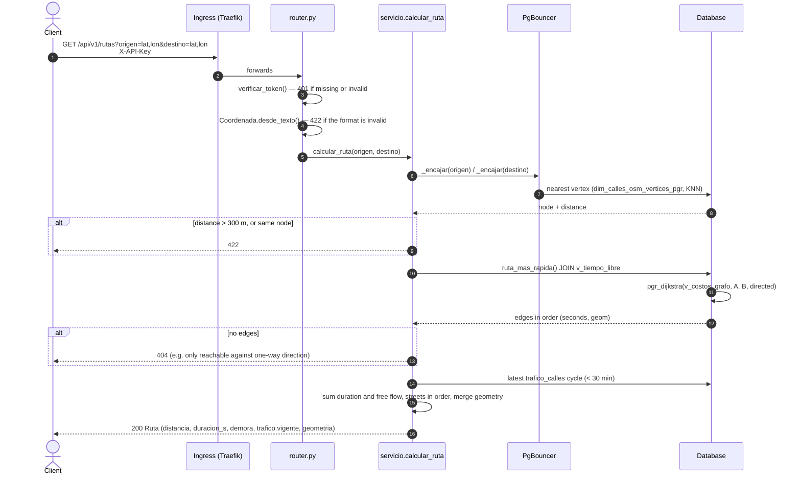
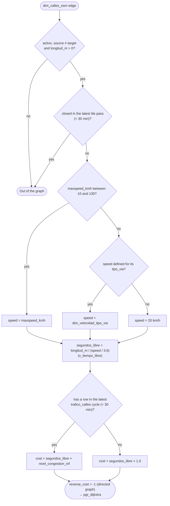

# Design: Routing with real traffic (Dijkstra on pgRouting)

> Status (2026-11-09): **traffic-aware routing implemented in the database** (migration 011, D14):
> `SELECT * FROM ruta_mas_rapida(lat_o, lon_o, lat_d, lon_d)`. Real test Historic Centre → UASLP University
> Zone with the 21:21 UTC traffic (15:21 local): 79 edges, 5.03 km, **10.4 min**;
> the same route at free flow would take 7.6 min (~2.8 min lost to congestion); 0.59 s to compute.
> Exposed in the API (D16): `GET /api/v1/rutas?origen=lat,lon&destino=lat,lon[&detalle=true]` → distance,
> duration with traffic and at free flow, delay, traffic freshness, streets and GeoJSON. Live (19:32 local,
> rush hour): Centre → UASLP 5.65 km, 8.3 min (7.6 at free flow), response in 0.29 s.
> Pending: validate ETAs with several days of data and calibrate free-flow speeds.

## Goal

Given the user's location and a destination in San Luis Potosí, return the **fastest route
considering current traffic**, not the shortest one. Besides the current heatmap
(`trafico_calles` in Grafana), the system can answer:

- What is the fastest route from A to B **right now**?
- How long does it take (ETA) and how far is it?
- How much time is lost to congestion compared with free flow?

## Why PostGIS instead of JSONB

The original rule ("geometry only in JSONB") was replaced because Dijkstra requires:
1. Topology (`source`/`target`), which pgRouting builds from PostGIS geometries.
2. Indexed spatial lookups (nearest node to a point, `<->` with GiST).
3. Spatial joins between TomTom segments and OSM edges.

JSONB (`dim_segmentos_viales.coordenadas_geometria`) remains only as a raw copy of TomTom's response.

## End-to-end flow

```
TomTom tiles ─▶ fact_flujo_aristas ─┬─▶ predictor v3 ─▶ trafico_calles (congestion per OSM edge)
                                    └─ closed ────────────────┐       │
                                                              ▼
                                          v_costos_grafo (cost = travel time with traffic)
                                                              │
  (lat,lon) origin ──snap──▶ vertex A                          │
  (lat,lon) dest. ───snap──▶ vertex B ──▶ pgr_dijkstra(v_costos_grafo, A, B, directed)
                                                              │
                                                              ▼
                                    route: edges + geometry + ETA + distance
```

### Route request (UML: sequence)

`GET /api/v1/rutas` end to end (`services/api/app/rutas/`, migrations 011–012).



## Cost function

### Cost of an edge (UML: activity)

What `v_costos_grafo` (012) does with each `dim_calles_osm` edge on every request.



`nivel_congestion` = `currentTravelTime / freeFlowTravelTime`, so it directly multiplies the
free-flow time:

```
free_time_s(edge) = longitud_m / (free_speed_kmh(tipo_via) / 3.6)
cost_s(edge)      = free_time_s × current_congestion(edge)
current_congestion = latest nivel_congestion_inf in trafico_calles for that osm_id,
                     or 1.0 if there is no recent data (> 30 min)
```

Initial free-flow speeds per road type (adjustable; ideally replaced by OSM's `maxspeed`
or by TomTom's `freeFlowSpeed` when the edge is measured):

| tipo_via | km/h |
|---|---|
| motorway, motorway_link | 80 / 50 |
| trunk, trunk_link | 70 / 40 |
| primary, primary_link | 50 / 35 |
| secondary, secondary_link | 45 / 30 |
| tertiary, tertiary_link | 40 / 30 |
| unclassified | 30 |
| residential | 25 |

### Directionality
The graph is directed: every two-way street is already duplicated with reversed geometry.
Therefore **`reverse_cost = -1`** and `directed => true`. See `DATABASE.md › dim_calles_osm`.

## Implementation (migration 011)

Everything lives in `db/migrations/011_ruteo.sql`:

| Object | What it does |
|---|---|
| `dim_velocidad_tipo_via` | Free-flow speed per road type (table above). Adjustable with `UPDATE` |
| `v_costos_grafo` | `id, source, target, cost (seconds), reverse_cost (-1)` with the latest cycle's traffic (< 30 min) |
| `ruta_mas_rapida(lat_o, lon_o, lat_d, lon_d)` | Snaps each coordinate to the nearest node (GiST) and runs `pgr_dijkstra` over the view. Returns `seq, osm_id, nombre, tipo_via, longitud_m, segundos, segundos_acumulados, geom` |

Differences from the original design (D14):
- **Closed roads excluded** from the graph (latest tile pass), not just made more expensive.
- **`LEFT JOIN`** to `dim_velocidad_tipo_via` with 20 km/h by default: an unlisted `tipo_via` (e.g.
  `living_street`) no longer makes the edge silently disappear.
- **OSM `maxspeed` only if between 10 and 130 km/h**; otherwise the road type's speed.
- Without recent traffic (> 30 min) the view uses free flow: the route is still valid, just without traffic.

```sql
-- Example: Historic Centre → UASLP University Zone
SELECT * FROM ruta_mas_rapida(22.1497, -100.9739, 22.1460, -101.0130);
```

Snapping limitations: the nearest **node** is used (not a point halfway along a street); if that node is only
reachable against a one-way direction, the function returns nothing. Future improvement: `pgr_withPoints`.

Tests: `tests/test_ruteo_db.py` (temporary database with a synthetic graph): short route without traffic, detour
around a jam, closed road excluded, stale traffic ignored, one-way respected, absurd `maxspeed`
discarded, unknown road type kept.

## Implementation plan

1. **Prior clean-up** (`DATABASE.md`): ✅ P1–P9 (2026-11-09).
2. **Routing migration (011):** ✅ `dim_velocidad_tipo_via`, `v_costos_grafo` and `ruta_mas_rapida()` (2026-11-09).
3. **API** (`services/api`): ✅ `GET /api/v1/rutas` (D16). The free-flow time comes from `v_tiempo_libre` (migration 012), the same view `v_costos_grafo` uses.
4. **Endpoint** `GET /api/v1/rutas?origen=lat,lon&destino=lat,lon` in `services/api` and add the service to `docker-compose.yml`.
5. **Validation:** compare ETAs against the TomTom Routing API on a sample of O/D pairs; adjust free-flow speeds.
6. **Future:** A* (`pgr_aStar`) for speed; costs predicted by time of day from the history in `fact_lecturas_trafico`; turn penalties.

## Traffic sources and TomTom quota

Free **monthly** quotas (current account, 2026-11): Flow Segment Data **20 000**; Traffic Flow vector
tiles **200 000**. With 440 points every 15 min the ETL used ~42 000 requests/day: the monthly quota
ran out within hours (the HTTP 403s of June–July).

**B.1 — Deduplication** (`scripts/deduplicar_puntos.py`): 440 → 207 points. With `zoom=10` TomTom returns
long segments and up to 12 points fell on the same one.

**B.2 — Request pool** (`src/presupuesto.py` + table `consumo_api`):
- Daily budget = (quota × 0.9 − used before today) / days left in the month (~600–820/day).
- Cycle allowance = daily budget × weight(local hour) / Σ weights of the day: peak 3 (~16 per cycle),
  off-peak 1 (~5), night 0.2 (~1). Whatever is not spent is spread over the following days.
- Every HTTP attempt counts (retries included); a 403 blocks the rest of the day.
- Points per cycle: never-measured ones first, then those with the oldest reading (rotation).
- Verified with a real cycle: 16/16 requests, usage recorded, inference for 67 464 streets.

Limitation: with ~800 requests/day each point is refreshed every ~3 h at peak and ~10 h off-peak; the
predictor only uses readings from the last 6 h, so live coverage is sparse (in the first
cycle, 75 % of the streets were out of reach of any source).

**A — Vector tile test** (`scripts/prueba_vector_tiles.py`, 2026-11-09, zoom 14):

| Metric | Result |
|---|---|
| Tiles per pass over the area | 49 (zoom 13: 16; zoom 15: 182) |
| Usage every 15 min all day | ~4 700/day ≈ 141 000/month (< 200 000) |
| Traffic segments per pass | 5 267, with `traffic_level` = current / free speed (0–1) and `road_closure` |
| OSM edges covered | 14 698 (22 %; 24 % of the km) |
| motorway / trunk / primary coverage | 98–99 % |
| secondary / tertiary coverage | 95 % / 80 % |
| residential coverage | 8 % (still needs IDW) |
| Agreement with Flow Segment Data (16 segments, ~10 min apart) | mean difference 0.052, max 0.211; detected the congestion on Av. Constitución (0.30 vs 0.32) |

**Result:** tiles become the main source (D8). Pending: verify that TomTom's terms allow storing data derived
from tiles.

### Implementation (main source)

`main.ciclo_etl` on each 15-minute cycle:
1. **Tiles** (`ciclo_tiles`): its own pool (200 000/month, all or nothing per pass, D12) →
   `extractor_tiles.extraer` (49 async tiles) → `asociador.asociar_y_guardar` → `fact_flujo_aristas`.
2. **Segment Data** (`ciclo_segment_data`): secondary source within its pool (B.2).
3. **Predictor** if any source brought data.

**Directed** matching (D9): each tile line goes to the OSM edge within 12 m of its midpoint with the
**same bearing** (< 35° over 360°). Validated with a real pass:
- One-way edges: 8 668 matched with the directed rule vs 2 880 with reversed segments (the opposite
  carriageway of divided avenues, which the directed rule avoids).
- 3 059 two-way pairs measured; in 32 % the level differs by direction.
- Coverage: motorway/trunk/primary ~100 %, secondary 98 %, tertiary 84 %, residential 8 %; 15 037 edges.
- Time: tile pass + matching ≈ 6 s (D11).

**Predictor v3** (D13): measured edges → direct value (`TILE`); the rest → IDW from the open measurements
(`IDW_TILE`). In a real cycle: 15 039 measured + 52 425 inferred, only 1 % of streets without a nearby source
(with Segment Data it was 72.5 %). Full ETL cycle: 10.7 s.

**Implications for routing** (pending, migration 011):
- The cost view uses `trafico_calles.nivel_congestion_inf` from the latest cycle, as designed.
- It must also **exclude** edges with `fact_flujo_aristas.cerrada` in the latest pass: a closed road
  is not "slow", it is impassable (in `trafico_calles` it only appears with the cap of 10).
- The congestion cap is now 10 (previously 3): severe jams weigh what they really cost.

## Known limitations
- Congestion on residential streets is mostly **inferred** (tiles measure ~8 % of them).
- ~~IDW clips congestion to [1, 3]~~ Resolved in D13: cap of 10 and direct measured values.
- If the ETL does not run (e.g. TomTom 403), the view falls back to free flow (1.0) and the route no longer reflects traffic.
