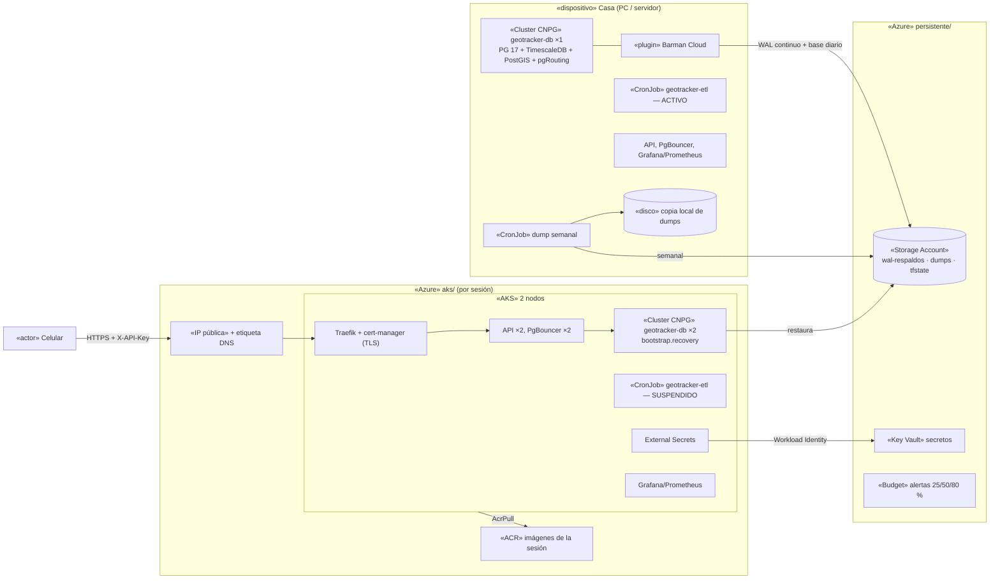
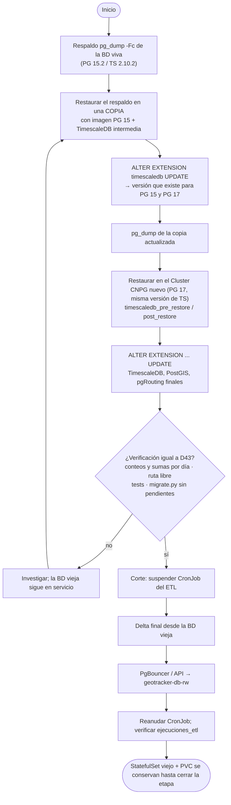
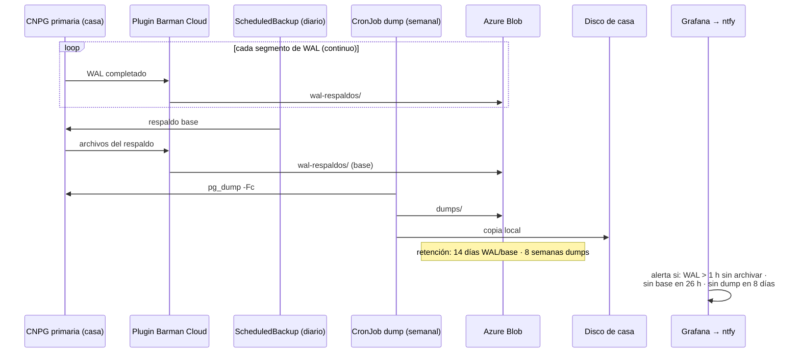
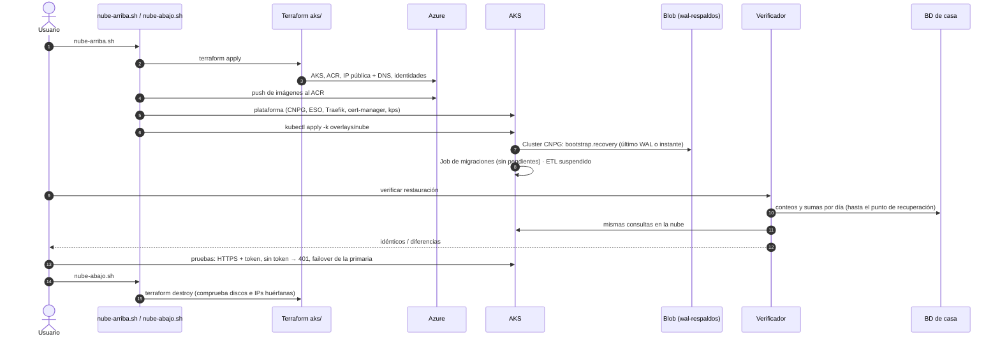
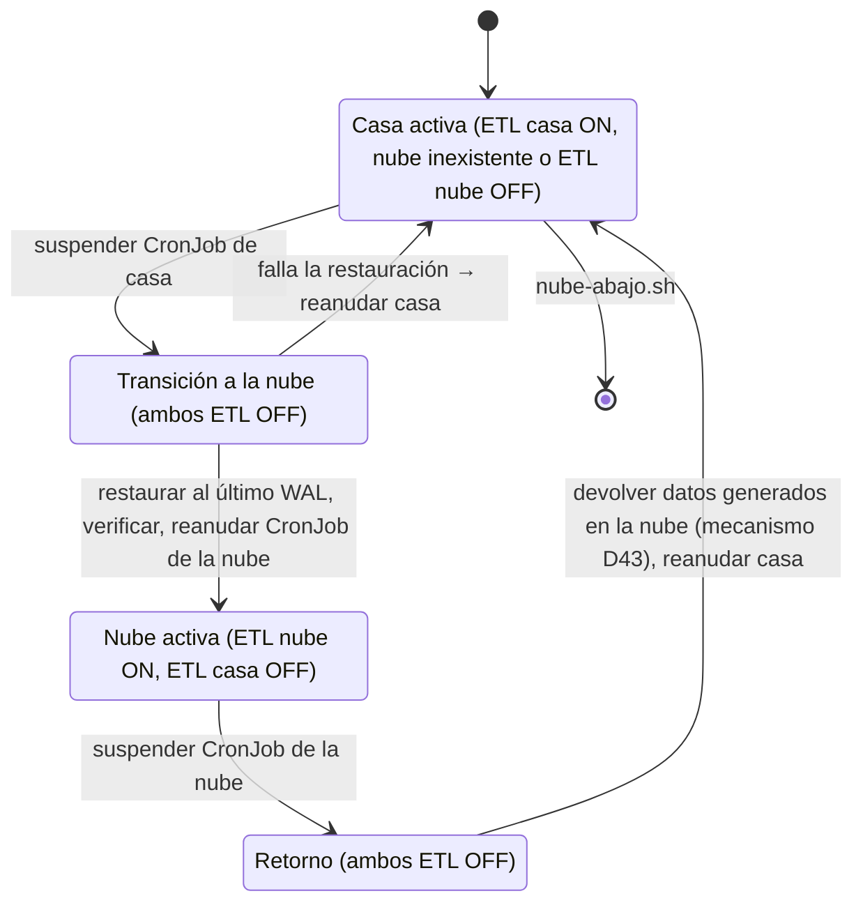

# Fase 2 — geoTracker en Azure/AKS: diseño

Fecha: 2026-11-20. Estado: borrador para aprobación. Contexto previo: `docs/KUBERNETES.md` (plan por fases,
decisiones D18–D44), `docs/DECISIONES.md`.

## 1. Intención y por qué

- **Para qué es Azure (palabras del usuario):** principalmente educativo, y además el plan "por si acaso": si algún
  día geoTracker tiene que correr en un entorno externo, el camino ya está construido y probado.
- **Dónde vive geoTracker de verdad:** en un **segundo equipo en casa** que hará de servidor, administrado de forma
  remota desde el equipo actual. Ese servidor es un proyecto aparte (ver §4); Azure no lo reemplaza.
- **Qué significa "por si acaso" para los datos (decidido):** poder **mudar el sistema vivo con su histórico**.
  Por eso el centro de la fase es: respaldos fuera de casa, en Azure, y un **ensayo de restauración** en la nube que
  demuestre que se puede levantar geoTracker allá con los datos de casa.
- **Éxito:** con un comando se crea todo en Azure desde el repo, se restaura el histórico de casa, se verifica que
  es idéntico (como en D43) y que el sistema funciona (ruta real, failover de la BD, acceso solo con token y TLS), y
  con otro comando se destruye. El crédito ($100 USD) paga **sesiones** de horas o días, no meses encendido.

## 2. Metas, no-metas y anti-metas

**Metas**
1. BD con **CloudNativePG** (CNPG) en todos los entornos, sobre una imagen nueva con versiones soportadas.
2. **Respaldos continuos** (WAL + respaldos base) de la BD de casa a Azure Blob Storage, más un **`pg_dump`
   semanal** como copia lógica independiente (opción C elegida).
3. **Infraestructura de Azure como código** con Terraform: una parte persistente (barata) y un cluster AKS efímero.
4. Overlay `nube` de Kustomize que despliega la misma app que en local, con TLS, token, restricción por IP y
   secretos desde Azure Key Vault.
5. **Ensayo de restauración** repetible y verificado, y un procedimiento documentado de **toma de control** (mudar
   el ETL a la nube) para el día que haga falta.
6. Costos medidos y con alarmas.

**No-metas (en esta fase)**
- CI/CD (Jenkins u otro): fase siguiente.
- Instalar el servidor de casa (proyecto aparte; hereda lo que aquí se haga en el overlay local).
- Un standby en vivo permanente en Azure (CNPG *replica cluster*): posible después; hoy costaría tenerlo encendido.
- API pública, multi-región, GitOps (Argo CD/Flux).

**Anti-metas (fracaso aunque "funcione")**
- Gasto sorpresa: que el cluster quede encendido sin saberlo y se coma el crédito (con el límite de gasto, agotarlo
  además apaga el almacenamiento de respaldos).
- **Dos ETL a la vez** con la misma clave de TomTom (casa y nube): excede la cuota (D29).
- Secretos o `tfstate` en git.
- Que la nube diverja tanto de casa que el ensayo de restauración no pruebe nada real (otra versión de BD, otro
  esquema, otra red OSM).
- Perder datos de casa durante la actualización de la BD.

## 3. Restricciones

- **Suscripción Azure for Students:** $100 USD de crédito por **12 meses** (renovable cada año mientras sea
  estudiante), sin tarjeta y con **límite de gasto**: al agotarse el crédito, Azure deshabilita los recursos —
  incluido el almacenamiento de respaldos. Estas suscripciones suelen tener una política de **regiones permitidas**
  y una **cuota de vCPU** baja; ambas se consultan al empezar (`az policy assignment list`, `az vm list-usage`) y
  acotan región y tamaño de nodos. Lo persistente tiene que costar centavos al mes: el crédito debe durar el año.
- AKS con plano de control gratuito; los nodos, disco y balanceador cuestan mientras existen (estimado sin
  verificar: ~$90/mes si quedara encendido; una sesión de unas horas, ~$1). Por eso sesiones.
- Una sola clave de TomTom (cuotas: tiles 200 000/mes, Segment Data 20 000/mes, pool en `consumo_api`).
- Imagen de BD actual fijada (PG 15.2 / TimescaleDB 2.10.2 / PostGIS 3.3.2 / pgRouting 4.0.1, D17) y **no es
  compatible con CNPG** tal cual (`03b` lo advierte). PG 15 deja de tener soporte en nov. 2027.
- **TimescaleDB solo restaura un `pg_dump` en la misma versión de la extensión** (luego se actualiza con
  `ALTER EXTENSION ... UPDATE`). Esto condiciona la actualización (§5.1) y el uso del dump semanal (§5.2).
  Corrige lo dicho en la conversación: el dump no es "independiente de versión"; es independiente del formato
  físico y del operador, pero pide la misma versión de TimescaleDB al restaurar.
- Reglas del repo: dependencias e imágenes con versión exacta; cambios de esquema solo por `db/migrations/`; cada
  decisión con entrada en `DECISIONES.md`; un dominio por herramienta (D18).
- Equipo local con ~7.6 GiB para Docker; el cluster local se apaga a diario.

## 4. Relación con el servidor de casa

El overlay `local` es la plantilla del servidor de casa. Todo lo que esta fase cambie en local (CNPG, respaldos a
Azure) lo hereda el servidor. Instalar el servidor (sistema operativo, k3s o k3d, acceso remoto, y ahí sí Ansible)
es un proyecto aparte que se planea después o en paralelo. Hasta entonces, **el equipo actual hace de "casa"**:
los respaldos salen de k3d.

## 5. Diseño

### 5.0 Orden de trabajo (y por qué)

1. **Etapa A — BD nueva y actualización (local).** Prerrequisito de todo lo demás: sin una imagen compatible con
   CNPG no hay respaldos continuos ni restauración en la nube.
2. **Etapa B — Base persistente en Azure + respaldos desde casa.** Terraform crea lo barato y duradero (storage,
   Key Vault, registro); la BD de casa empieza a respaldarse ahí.
3. **Etapa C — Cluster AKS efímero + overlay `nube`.** Se levanta, se despliega, se prueba, se destruye.
4. **Etapa D — Ensayo de restauración y toma de control.** El objetivo de la fase.

Cada etapa termina con su verificación y su decisión en `DECISIONES.md` (D45 en adelante).

**Despliegue objetivo (UML: despliegue).** Casa respalda de forma continua a la parte persistente de Azure; el
cluster efímero se crea por sesión y restaura desde ahí.

### 5.1 Etapa A — Imagen de BD para CNPG y actualización de versiones

- **Imagen nueva** sobre la imagen oficial de CNPG con PostGIS (`ghcr.io/cloudnative-pg/postgis`) + TimescaleDB +
  pgRouting, todo con versión exacta y base fijada por digest (como D17). Objetivo de versiones: **PostgreSQL 17**
  con las versiones de TimescaleDB, PostGIS y pgRouting más recientes que existan empaquetadas para PG 17 — llamada
  mía: saltar a 17 ahora evita repetir la migración antes de nov. 2027. El constructor confirma las versiones exactas.
- **Camino de actualización (llamada mía; el constructor lo valida):** por la restricción de TimescaleDB,
  1. respaldo `pg_dump -Fc` de la BD actual (como D43);
  2. llevar TimescaleDB de 2.10.2 a una versión que exista **para PG 15 y para PG 17** (imagen PG 15 intermedia
     con esa versión + `ALTER EXTENSION timescaledb UPDATE`), sobre una **copia**, no sobre la BD viva;
  3. dump de esa copia → restaurar en el `Cluster` CNPG nuevo (PG 17, misma versión de TimescaleDB) con
     `timescaledb_pre_restore()` / `timescaledb_post_restore()`;
  4. `ALTER EXTENSION ... UPDATE` a las versiones finales (TimescaleDB, PostGIS, pgRouting);
  5. verificación igual que D43 (conteos y sumas exactas por día y tabla, ruta a flujo libre idéntica) más la
     suite de tests y `migrate.py` sin pendientes;
  6. corte: suspender el `CronJob` del ETL, último dump/delta, repuntar PgBouncer/API a `geotracker-db-rw`,
     reanudar el ETL. El `StatefulSet` viejo y su PVC se conservan hasta cerrar la etapa.
**Camino de actualización (UML: actividad).**

- **Manifiestos:** `03b-database-cnpg.yaml` reescrito para la imagen nueva; `base` deja de incluir `03` y pasa a
  `03b`; el operador CNPG (versión fija) se instala con su manifiesto/Helm como componente de plataforma.
  Instancias: **1 en local/casa** (memoria), **2 en la nube** (primaria + réplica, suficiente para probar failover
  con 2 nodos; `03b` decía 3 — llamada mía por costo).
- **Lo que no cambia:** esquema (las migraciones 001–015 siguen igual), red OSM e IDs (D43), rol `grafana_ro`,
  `ejecuciones_etl`, continuous aggregate (se refresca tras restaurar, como en D43).
- Los parámetros de memoria de D39 pasan a `spec.postgresql.parameters` del `Cluster`.

### 5.2 Etapa B — Base persistente en Azure y respaldos

**Terraform en dos raíces** (`deploy/terraform/`):
- `persistente/` (se crea una vez y cuesta centavos al mes):
  - grupo de recursos; cuenta de almacenamiento con contenedores `wal-respaldos` (CNPG), `dumps` (semanal) y
    `tfstate` (estado remoto de Terraform, con bloqueo nativo de Azure Blob);
  - **Azure Key Vault** con los secretos (DB, TomTom, tokens de API, Grafana, ntfy);
  - presupuesto de Azure con alertas por correo (p. ej. 25/50/80 % del crédito anual).
  - **Sin registro de imágenes persistente** — llamada mía: un ACR Basic (~$5/mes) se comería ~60 % del crédito
    anual de Azure for Students. El ACR vive en la raíz efímera `aks/` y las imágenes se suben al empezar cada
    sesión (más lento; conviene reducir el tamaño de las imágenes, riesgo ya anotado en `KUBERNETES.md`).
  - El `tfstate` de esta raíz arranca en local y se migra al contenedor `tfstate` tras el primer `apply`
    (problema del huevo y la gallina; procedimiento documentado).
- `aks/` (efímera, §5.3).

**Respaldos de casa:**
- **Continuos:** plugin Barman Cloud de CNPG → `wal-respaldos`. Archivo de WAL continuo + `ScheduledBackup` base
  diario. Retención: 14 días (llamada mía). Credenciales en casa: SAS o clave de la cuenta en un `Secret`
  generado desde un archivo fuera de git (como D27).
- **Semanal lógico:** `CronJob` con `pg_dump -Fc` → `dumps`, retención 8 semanas (llamada mía). Es la copia que
  sobrevive a una corrupción física y la que sirve para saltos de versión (§3). **También se guarda en un disco
  de casa** (llamada mía): si la suscripción de estudiante caduca o se agota el crédito, Azure deshabilita el
  almacenamiento y los respaldos de allá dejan de estar disponibles.
**Flujo de respaldos (UML: secuencia).**

- **Observabilidad:** alertas nuevas como código (mismo patrón D40–D42): "WAL sin archivar > 1 h", "sin respaldo
  base en 26 h", "sin dump en 8 días", con aviso por ntfy.
- **Verificación de la etapa:** listar el contenido en Blob; restaurar el respaldo base + WAL en un `Cluster`
  temporal **en k3d** (antes de gastar en AKS) y pasar el verificador de §5.4.

### 5.3 Etapa C — Cluster AKS efímero y overlay `nube`

**`deploy/terraform/aks/`** (lee los datos de `persistente/` por `terraform_remote_state` o data sources):
- AKS tier gratuito, 1 pool de **2 nodos** pequeños (tamaño lo elige el constructor según la línea base de
  `KUBERNETES.md` y la cuota de vCPU de la suscripción), identidad administrada.
- ACR Basic de la sesión, con `AcrPull` para el cluster; se destruye con él.
- **Workload Identity**: CNPG (lectura/escritura en Blob) y External Secrets (lectura de Key Vault) sin claves
  guardadas en el cluster.
- IP pública con **etiqueta DNS de Azure** (`<etiqueta>.<región>.cloudapp.azure.com`): da un nombre para TLS sin
  comprar dominio — llamada mía.
- Región: la más cercana a SLP entre las **permitidas por la política de la suscripción de estudiante** y con AKS
  (candidatas: `mexicocentral`, `southcentralus`); el constructor la confirma como primer paso de la etapa B.

**Plataforma en el cluster** (versiones fijas, instalada desde scripts del repo):
- Operador CNPG + plugin Barman Cloud.
- **External Secrets Operator** leyendo de Key Vault — llamada mía, en lugar de Sealed Secrets: con un cluster que
  se destruye y recrea, la clave de Sealed Secrets se perdería en cada sesión; Key Vault persiste fuera del cluster.
- **Traefik** como Ingress (el mismo controlador que k3d: paridad con local) + **cert-manager** con Let's Encrypt
  (HTTP-01). **Acceso: token + TLS** (decidido por el usuario), sin lista de IPs: el celular con datos móviles
  cambia de IP. Una red privada (p. ej. Tailscale) queda como paso posterior opcional.
- `kube-prometheus-stack` con los mismos valores que local + ajustes de nube; dashboards y alertas desde
  `platform/` sin cambios. **Alertas: Grafana Alerting con ntfy, igual que en local** — llamada mía que contradice
  D31 ("Alertmanager en la nube"): duplicar las reglas en dos formatos no enseña lo suficiente para su costo.
  Tema de ntfy distinto al de casa.

**Overlay `deploy/k8s/overlays/nube/`:**
- `Cluster` CNPG con 2 instancias, `storageClass` administrada de Azure, `bootstrap.recovery` desde
  `wal-respaldos` (§5.4) en lugar de `initdb`.
- API con 2 réplicas (PDB y `topologySpreadConstraints` ya existen en `base`), PgBouncer 2 réplicas.
- **`CronJob` del ETL con `suspend: true` por defecto** (anti-meta: dos ETL).
- **Sin el `Job` de la red OSM**: la red llega con la restauración.
- `Job` de migraciones igual (idempotente: tras restaurar no debe aplicar nada).
- Secretos vía `ExternalSecret` (mismos nombres de `Secret` que local: `geotracker-secret`, `grafana-secret`).
- Imágenes desde ACR con tag fijo (no `latest`): el constructor define el esquema de tags; CI/CD lo
  automatizará después.

**Scripts de sesión** (`deploy/scripts/` o similar): `nube-arriba.sh` (terraform apply `aks/` → plataforma →
`apply -k overlays/nube` → espera a que todo esté sano) y `nube-abajo.sh` (destroy de `aks/`, comprobando que no
quedan discos ni IPs huérfanas). `persistente/` nunca se destruye desde estos scripts.

### 5.4 Etapa D — Ensayo de restauración y toma de control

**Ensayo (repetible, el criterio central de la fase):**
1. `nube-arriba.sh` con recuperación desde el último respaldo base + WAL (o a un instante dado).
2. **Verificador de restauración** (generaliza el de D43): compara casa vs nube por día y tabla (conteos y sumas
   exactas en `numeric`, la suma ponderada por `u`) hasta el punto de recuperación; misma ruta a flujo libre;
   `schema_migrations` y versiones de extensiones iguales.
3. Pruebas de la nube: ruta real por HTTPS con token; sin token → 401; HTTP sin TLS → redirigido; borrar el
   pod primario de la BD → la réplica asume y la API sigue respondiendo (failover); dashboards y alertas cargados.
4. Registrar tiempos (cuánto tarda la restauración) y costo de la sesión.
5. `nube-abajo.sh`.
**Sesión con ensayo de restauración (UML: secuencia).**

- **Variante con el dump semanal** (menos frecuente, p. ej. una vez al cerrar la fase y luego trimestral):
  restaurar desde `dumps` en vez de WAL, con la misma versión de TimescaleDB, y pasar el mismo verificador.

**Toma de control (documentada y ensayada una vez):** suspender el `CronJob` de casa → restauración en la nube al
último WAL → reanudar el `CronJob` de la nube → verificar ciclos en `ejecuciones_etl` → y la vuelta (suspender
nube, reanudar casa; los datos generados en la nube durante la toma se devuelven con el mismo mecanismo de D43).
Nunca dos `CronJob` activos.

**Toma de control (UML: estados).** Invariante: en todo estado hay como mucho un `CronJob` del ETL activo.

### 5.5 Documentación y decisiones

- `docs/KUBERNETES.md`: fase 2 reescrita con este diseño; preguntas 8 (Terraform/`tfstate`) y 10 (canal) cerradas.
- `DECISIONES.md`: una entrada por decisión de etapa (imagen/versiones, actualización, respaldos, Terraform en dos
  raíces, External Secrets, Traefik + etiqueta DNS, alertas en la nube, ensayo).
- `DATABASE.md`: versiones nuevas del motor.
- Runbooks: actualización, sesión en la nube, ensayo de restauración, toma de control.

## 6. Enfoques considerados

| Enfoque | A favor | En contra |
|---|---|---|
| A. `pg_dump` nocturno a Blob + restauración lógica | Simple; sin depender de CNPG en casa | Hasta un día de pérdida; restauración lenta al crecer; no ejercita los respaldos de CNPG |
| B. CNPG en casa con respaldos continuos (WAL) a Blob | Pérdida de minutos; misma BD en todos lados; recuperación a un instante | Requiere la imagen nueva y la actualización **antes** de Azure |
| **C. B + `pg_dump` semanal (elegido)** | Lo de B, más una copia lógica que sobrevive a corrupción física y sirve para saltos de versión | Lo de B, más un `CronJob` y su almacenamiento |

**Elegido: C**, por el usuario, tras la recomendación: la actualización de la BD era prerrequisito de todos modos,
el servidor de casa es una instalación nueva (empezar en CNPG cuesta poco) y el dump semanal cubre lo que los
respaldos físicos no.

## 7. Decidido por el usuario vs llamadas mías

**Decidido por el usuario:** propósito educativo + "por si acaso"; servidor de casa como sistema real; mudar el
sistema vivo con su histórico (respaldos + ensayo de restauración); enfoque C; CI/CD después; acceso a la API en
la nube por token + TLS (sin lista de IPs); suscripción Azure for Students.

**Llamadas mías (revisables):** PostgreSQL 17; camino de actualización vía versión intermedia de TimescaleDB;
2 instancias de BD en la nube y 1 en casa; Terraform en dos raíces; ACR efímero por sesión (no persistente, por
el crédito anual); dump semanal también en un disco de casa; External Secrets + Key
Vault en vez de Sealed Secrets; Traefik + etiqueta DNS de Azure en vez de dominio propio; Grafana Alerting en la
nube (revierte parte de D31); retenciones (14 días WAL/base, 8 semanas dumps); sin `Job` OSM en la nube; Ansible
fuera de esta fase (pasa al proyecto del servidor de casa, donde sí prepara hosts).

## 8. Lo que queda al constructor

Versiones exactas (imagen CNPG, TimescaleDB, PostGIS, pgRouting, operador, plugin, charts, Terraform/proveedor
azurerm); tamaño de nodos y región dentro de la política y la cuota de la suscripción de estudiante; ruta del
disco de casa para la copia del dump; esquema de tags de imágenes; forma exacta de los scripts
de sesión y del verificador; nombres de recursos de Azure; umbrales de las alertas de respaldo; cómo exponer a
Grafana en la nube (port-forward o detrás del mismo Ingress con autenticación).
