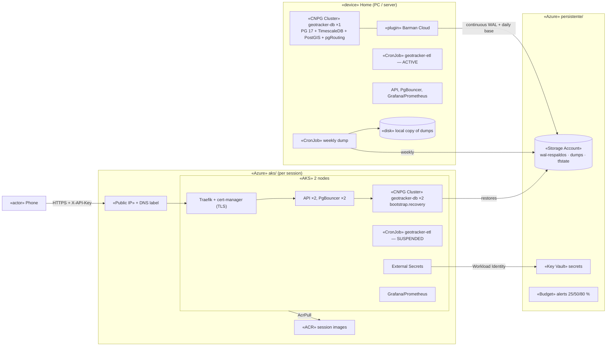
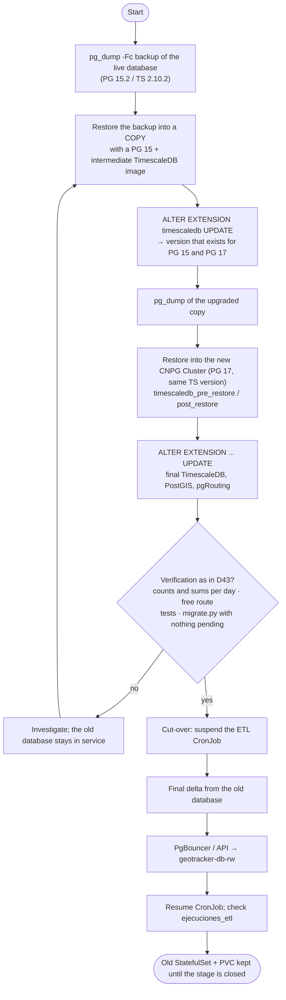
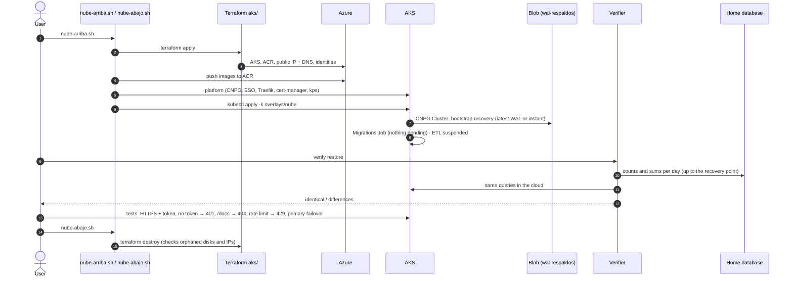
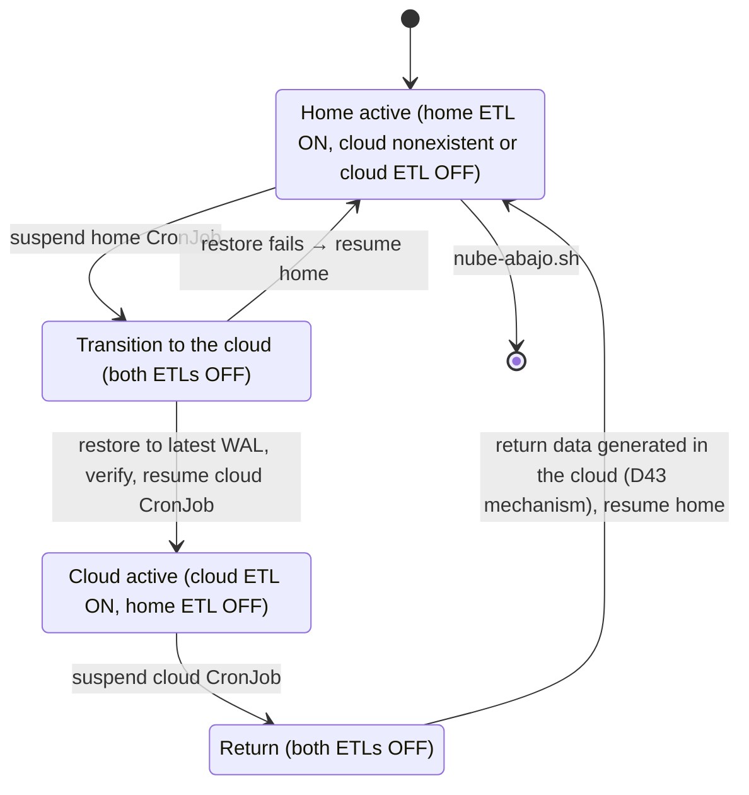

# Phase 2 — geoTracker on Azure/AKS: design

Date: 2026-11-20. Status: draft for approval. Prior context: `docs/KUBERNETES.md` (phased plan,
decisions D18–D44), `docs/DECISIONES.md`. Updated 2026-11-27: API access in the cloud (D49).

## 1. Intent and why

- **What Azure is for (the user's words):** mainly educational, and also the "just in case" plan: if geoTracker
  ever has to run in an external environment, the path is already built and tested.
- **Where geoTracker really lives:** on a **second computer at home** that will act as a server, managed
  remotely from the current computer. That server is a separate project (see §4); Azure does not replace it.
- **What "just in case" means for the data (decided):** being able to **move the live system with its history**.
  That is why the core of the phase is: off-site backups, in Azure, and a **restore drill** in the cloud that
  proves geoTracker can be brought up there with the home data.
- **Success:** with one command everything is created in Azure from the repo, the home history is restored, it is verified to be
  identical (as in D43) and the system works (real route, database failover, access only with token and TLS), and
  with another command it is destroyed. The credit ($100 USD) pays for **sessions** of hours or days, not months switched on.

## 2. Goals, non-goals and anti-goals

**Goals**
1. Database on **CloudNativePG** (CNPG) in every environment, on a new image with supported versions.
2. **Continuous backups** (WAL + base backups) of the home database to Azure Blob Storage, plus a **weekly
   `pg_dump`** as an independent logical copy (option C chosen).
3. **Azure infrastructure as code** with Terraform: a persistent (cheap) part and an ephemeral AKS cluster.
4. A `nube` Kustomize overlay that deploys the same app as locally, with TLS, token, rate limiting and
   secrets from Azure Key Vault.
5. A repeatable, verified **restore drill**, and a documented **takeover** procedure (moving
   the ETL to the cloud) for the day it is needed.
6. Measured costs with alarms.

**Non-goals (in this phase)**
- CI/CD (Jenkins or other): next phase.
- Installing the home server (separate project; it inherits whatever is done here in the local overlay).
- A permanent live standby in Azure (CNPG *replica cluster*): possible later; today keeping it on would cost money.
- Public API, multi-region, GitOps (Argo CD/Flux).

**Anti-goals (failure even if it "works")**
- Surprise spending: the cluster left on unnoticed eating the credit (with the spending limit, exhausting it
  also shuts down the backup storage).
- **Two ETLs at once** with the same TomTom key (home and cloud): exceeds the quota (D29).
- Secrets or `tfstate` in git.
- The cloud diverging so much from home that the restore drill proves nothing real (another database version, another
  schema, another OSM network).
- Losing home data during the database upgrade.

## 3. Constraints

- **Azure for Students subscription:** $100 USD of credit for **12 months** (renewable every year while a
  student), no card and with a **spending limit**: when the credit runs out, Azure disables the resources —
  including backup storage. These subscriptions usually have an **allowed regions** policy
  and a low **vCPU quota**; both are checked at the start (`az policy assignment list`, `az vm list-usage`) and
  bound the region and node size. The persistent part has to cost cents per month: the credit must last the year.
- AKS with a free control plane; nodes, disk and load balancer cost money while they exist (unverified estimate:
  ~$90/month if left on; a session of a few hours, ~$1). Hence sessions.
- A single TomTom key (quotas: tiles 200 000/month, Segment Data 20 000/month, pool in `consumo_api`).
- The current database image is pinned (PG 15.2 / TimescaleDB 2.10.2 / PostGIS 3.3.2 / pgRouting 4.0.1, D17) and **is not
  compatible with CNPG** as-is (`03b` warns about it). PG 15 goes out of support in Nov. 2027.
- **TimescaleDB only restores a `pg_dump` on the same extension version** (then it is upgraded with
  `ALTER EXTENSION ... UPDATE`). This conditions the upgrade (§5.1) and the use of the weekly dump (§5.2).
  It corrects what was said in the conversation: the dump is not "version-independent"; it is independent of the
  physical format and the operator, but it needs the same TimescaleDB version when restoring.
- Repo rules: dependencies and images at exact versions; schema changes only through `db/migrations/`; every
  decision with an entry in `DECISIONES.md`; one domain per tool (D18).
- Local computer with ~7.6 GiB for Docker; the local cluster is shut down daily.

## 4. Relationship with the home server

The `local` overlay is the template for the home server. Everything this phase changes locally (CNPG, backups to
Azure) is inherited by the server. Installing the server (operating system, k3s or k3d, remote access, and there Ansible)
is a separate project planned afterwards or in parallel. Until then, **the current computer acts as "home"**:
the backups come from k3d.

## 5. Design

### 5.0 Order of work (and why)

1. **Stage A — New database and upgrade (local).** A prerequisite for everything else: without a CNPG-compatible image
   there are no continuous backups or restores in the cloud.
2. **Stage B — Persistent base in Azure + backups from home.** Terraform creates the cheap, durable part (storage,
   Key Vault, registry); the home database starts backing up there.
3. **Stage C — Ephemeral AKS cluster + `nube` overlay.** Brought up, deployed, tested, destroyed.
4. **Stage D — Restore drill and takeover.** The goal of the phase.

Each stage ends with its verification and its decision in `DECISIONES.md` (D45 onwards).

**Target deployment (UML: deployment).** Home continuously backs up to the persistent part of Azure; the
ephemeral cluster is created per session and restores from there.

### 5.1 Stage A — Database image for CNPG and version upgrade

- **New image** on top of the official CNPG image with PostGIS (`ghcr.io/cloudnative-pg/postgis`) + TimescaleDB +
  pgRouting, all at exact versions and with the base pinned by digest (as in D17). Version target: **PostgreSQL 17**
  with the most recent TimescaleDB, PostGIS and pgRouting versions packaged for PG 17 — my call:
  jumping to 17 now avoids repeating the migration before Nov. 2027. The builder confirms the exact versions.
- **Upgrade path (my call; the builder validates it):** because of the TimescaleDB constraint,
  1. `pg_dump -Fc` backup of the current database (as in D43);
  2. bring TimescaleDB from 2.10.2 to a version that exists **for both PG 15 and PG 17** (intermediate PG 15 image
     with that version + `ALTER EXTENSION timescaledb UPDATE`), on a **copy**, not on the live database;
  3. dump that copy → restore into the new CNPG `Cluster` (PG 17, same TimescaleDB version) with
     `timescaledb_pre_restore()` / `timescaledb_post_restore()`;
  4. `ALTER EXTENSION ... UPDATE` to the final versions (TimescaleDB, PostGIS, pgRouting);
  5. verification as in D43 (exact counts and sums per day and table, identical free-flow route) plus the
     test suite and `migrate.py` with nothing pending;
  6. cut-over: suspend the ETL `CronJob`, last dump/delta, repoint PgBouncer/API to `geotracker-db-rw`,
     resume the ETL. The old `StatefulSet` and its PVC are kept until the stage is closed.
**Upgrade path (UML: activity).**

- **Manifests:** `03b-database-cnpg.yaml` rewritten for the new image; `base` stops including `03` and switches to
  `03b`; the CNPG operator (pinned version) is installed with its manifest/Helm as a platform component.
  Instances: **1 locally/at home** (memory), **2 in the cloud** (primary + replica, enough to test failover
  with 2 nodes; `03b` said 3 — my call, for cost).
- **What does not change:** schema (migrations 001–015 stay the same), OSM network and IDs (D43), `grafana_ro` role,
  `ejecuciones_etl`, continuous aggregate (refreshed after restoring, as in D43).
- D39's memory parameters move to the `Cluster`'s `spec.postgresql.parameters`.

### 5.2 Stage B — Persistent base in Azure and backups

**Terraform in two roots** (`deploy/terraform/`):
- `persistente/` (created once and costs cents per month):
  - resource group; storage account with containers `wal-respaldos` (CNPG), `dumps` (weekly) and
    `tfstate` (Terraform remote state, with Azure Blob's native locking);
  - **Azure Key Vault** with the secrets (database, TomTom, API tokens, Grafana, ntfy);
  - Azure budget with email alerts (e.g. 25/50/80 % of the annual credit).
  - **No persistent image registry** — my call: an ACR Basic (~$5/month) would eat ~60 % of the annual
    Azure for Students credit. The ACR lives in the ephemeral `aks/` root and images are pushed at the start of each
    session (slower; it pays to reduce image size, a risk already noted in `KUBERNETES.md`).
  - This root's `tfstate` starts locally and is migrated to the `tfstate` container after the first `apply`
    (chicken-and-egg problem; procedure documented).
- `aks/` (ephemeral, §5.3).

**Home backups:**
- **Continuous:** CNPG's Barman Cloud plugin → `wal-respaldos`. Continuous WAL archiving + a daily base
  `ScheduledBackup`. Retention: 14 days (my call). Credentials at home: SAS or the account key in a `Secret`
  generated from a file outside git (as in D27).
- **Weekly logical:** `CronJob` with `pg_dump -Fc` → `dumps`, 8-week retention (my call). It is the copy that
  survives physical corruption and the one that works for version jumps (§3). **It is also stored on a home
  disk** (my call): if the student subscription expires or the credit runs out, Azure disables the
  storage and the backups there become unavailable.
**Backup flow (UML: sequence).**

- **Observability:** new alerts as code (same pattern as D40–D42): "WAL unarchived > 1 h", "no base
  backup in 26 h", "no dump in 8 days", notified through ntfy.
- **Stage verification:** list the contents in Blob; restore the base backup + WAL into a temporary `Cluster`
  **on k3d** (before spending on AKS) and run the §5.4 verifier.

### 5.3 Stage C — Ephemeral AKS cluster and `nube` overlay

**`deploy/terraform/aks/`** (reads `persistente/`'s data via `terraform_remote_state` or data sources):
- AKS free tier, 1 pool of **2 small nodes** (size chosen by the builder from the `KUBERNETES.md`
  baseline and the subscription's vCPU quota), managed identity.
- Session ACR Basic, with `AcrPull` for the cluster; destroyed with it.
- **Workload Identity**: CNPG (read/write to Blob) and External Secrets (read from Key Vault) without keys
  stored in the cluster.
- Public IP with an **Azure DNS label** (`<label>.<region>.cloudapp.azure.com`): gives a name for TLS without
  buying a domain — my call.
- Region: the closest to SLP among those **allowed by the student subscription's policy** and with AKS
  (candidates: `mexicocentral`, `southcentralus`); the builder confirms it as the first step of stage B.

**Platform in the cluster** (pinned versions, installed from repo scripts):
- CNPG operator + Barman Cloud plugin.
- **External Secrets Operator** reading from Key Vault — my call, instead of Sealed Secrets: with a cluster that
  is destroyed and recreated, the Sealed Secrets key would be lost on every session; Key Vault persists outside the cluster.
- **Traefik** as Ingress (the same controller as k3d: parity with local) + **cert-manager** with Let's Encrypt
  (HTTP-01). **Access: token + TLS, hardened** (decided by the user, D49), no IP list: the phone on mobile data
  changes IP. A private network (e.g. Tailscale) is an optional later step. Hardening:
  - **Rate limit per client** with a Traefik `rateLimit` middleware on the API Ingress; over the limit → 429.
    It needs the real client IP: Traefik's Service uses `externalTrafficPolicy: Local` — my call; with the
    default (`Cluster`) clients can reach Traefik with a node's address and share one limit.
  - **Only `/api` is published.** The `nube` overlay removes `/docs` and `/openapi.json` from the Ingress (the
    local one keeps them, D32); in the cloud they are reached with `kubectl port-forward`.
- `kube-prometheus-stack` with the same values as locally + cloud adjustments; dashboards and alerts from
  `platform/` unchanged. **Alerts: Grafana Alerting with ntfy, same as locally** — my call that contradicts
  D31 ("Alertmanager in the cloud"): duplicating the rules in two formats does not teach enough for its cost.
  A different ntfy topic from home's.

**`deploy/k8s/overlays/nube/` overlay:**
- CNPG `Cluster` with 2 instances, Azure managed `storageClass`, `bootstrap.recovery` from
  `wal-respaldos` (§5.4) instead of `initdb`.
- API with 2 replicas (PDB and `topologySpreadConstraints` already exist in `base`), PgBouncer 2 replicas.
- **ETL `CronJob` with `suspend: true` by default** (anti-goal: two ETLs).
- **No OSM network `Job`**: the network arrives with the restore.
- Migrations `Job` unchanged (idempotent: after restoring it must apply nothing).
- Secrets via `ExternalSecret` (same `Secret` names as locally: `geotracker-secret`, `grafana-secret`).
- Images from ACR with a fixed tag (not `latest`): the builder defines the tagging scheme; CI/CD will
  automate it later.

**Session scripts** (`deploy/scripts/` or similar): `nube-arriba.sh` (terraform apply `aks/` → platform →
`apply -k overlays/nube` → wait until everything is healthy) and `nube-abajo.sh` (destroy `aks/`, checking that no
orphaned disks or IPs remain). `persistente/` is never destroyed from these scripts.

### 5.4 Stage D — Restore drill and takeover

**Drill (repeatable, the central criterion of the phase):**
1. `nube-arriba.sh` with recovery from the latest base backup + WAL (or to a given instant).
2. **Restore verifier** (generalizes D43's): compares home vs cloud per day and table (exact counts and sums
   in `numeric`, the sum weighted by `u`) up to the recovery point; same free-flow route;
   equal `schema_migrations` and extension versions.
3. Cloud tests: real route over HTTPS with token; no token → 401; HTTP without TLS → redirected; `/docs` and
   `/openapi.json` on the public address → 404; a burst over the rate limit → 429, while a second client (another
   public IP) still gets through; delete the database's primary pod → the replica takes over and the API keeps
   responding (failover); dashboards and alerts loaded.
4. Record times (how long the restore takes) and the session's cost.
5. `nube-abajo.sh`.
**Session with restore drill (UML: sequence).**

- **Variant with the weekly dump** (less frequent, e.g. once when closing the phase and then quarterly):
  restore from `dumps` instead of WAL, with the same TimescaleDB version, and run the same verifier.

**Takeover (documented and rehearsed once):** suspend the home `CronJob` → restore in the cloud to the
latest WAL → resume the cloud `CronJob` → check cycles in `ejecuciones_etl` → and the way back (suspend
cloud, resume home; the data generated in the cloud during the takeover is returned with the same mechanism as D43).
Never two active `CronJob`s.

**Takeover (UML: states).** Invariant: in every state there is at most one active ETL `CronJob`.

### 5.5 Documentation and decisions

- `docs/KUBERNETES.md`: phase 2 rewritten with this design; questions 8 (Terraform/`tfstate`) and 10 (channel) closed.
- `DECISIONES.md`: one entry per stage decision (image/versions, upgrade, backups, Terraform in two
  roots, External Secrets, Traefik + DNS label, cloud alerts, drill). API access is already recorded (D49);
  D45–D48 are reserved by the stage A plan.
- `DATABASE.md`: new engine versions.
- Runbooks: upgrade, cloud session, restore drill, takeover.

## 6. Approaches considered

### Backups

| Approach | Pros | Cons |
|---|---|---|
| A. Nightly `pg_dump` to Blob + logical restore | Simple; no dependency on CNPG at home | Up to a day of loss; slow restore as it grows; does not exercise CNPG backups |
| B. CNPG at home with continuous (WAL) backups to Blob | Minutes of loss; same database everywhere; point-in-time recovery | Requires the new image and the upgrade **before** Azure |
| **C. B + weekly `pg_dump` (chosen)** | B's benefits, plus a logical copy that survives physical corruption and works for version jumps | B's costs, plus a `CronJob` and its storage |

**Chosen: C**, by the user, after the recommendation: the database upgrade was a prerequisite anyway,
the home server is a new installation (starting on CNPG costs little) and the weekly dump covers what physical
backups do not.

### API access in the cloud

| Approach | Pros | Cons |
|---|---|---|
| **A. Token + TLS, hardened (chosen)** | Works from any network, including mobile data; exercises public HTTPS | The endpoint is visible to internet scanners |
| B. A + IP allow-list | A stolen token is useless from other addresses | The list must be updated whenever an address changes; needs the real client IP |
| C. Private network (Tailscale) | No public endpoint | A client on every device and an outside service; does not exercise public TLS |

**Chosen: A**, by the user (2026-11-27, D49): sessions last hours or days and the phone is one of the clients, so
an IP list adds friction for limited extra protection.

## 7. Decided by the user vs my calls

**Decided by the user:** educational purpose + "just in case"; home server as the real system; move the
live system with its history (backups + restore drill); approach C; CI/CD later; access to the API in
the cloud by token + TLS (no IP list), with rate limiting at Traefik and without public `/docs` or
`/openapi.json`; Azure for Students subscription.

**My calls (reviewable):** PostgreSQL 17; upgrade path via an intermediate TimescaleDB version;
2 database instances in the cloud and 1 at home; Terraform in two roots; ephemeral per-session ACR (not persistent, because of
the annual credit); weekly dump also on a home disk; External Secrets + Key
Vault instead of Sealed Secrets; Traefik + Azure DNS label instead of an own domain; rate limit per client with
`externalTrafficPolicy: Local`; Grafana Alerting in the
cloud (reverts part of D31); retention periods (14 days WAL/base, 8 weeks dumps); no OSM `Job` in the cloud; Ansible
out of this phase (moves to the home server project, where it does prepare hosts).

## 8. Left to the builder

Exact versions (CNPG image, TimescaleDB, PostGIS, pgRouting, operator, plugin, charts, Terraform/azurerm
provider); node size and region within the student subscription's policy and quota; path of the
home disk for the dump copy; image tagging scheme; exact shape of the session scripts
and the verifier; Azure resource names; backup alert thresholds; rate limit values (average and burst); how to expose
Grafana in the cloud (port-forward or behind the same Ingress with authentication).
